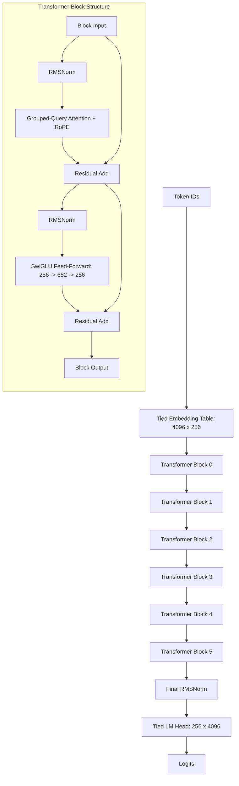

# ChakrView: Indigenous Sovereign Conversational Neural Foundation
[](#current-development-status)
[](#license-status)
[](#model-architecture-specifications)
[](#pretraining-methodology)
[](#sft-methodology)

---

## 1. Project Overview & Vision

**ChakrView** is an indigenous, sovereign, modular neural language model and cognitive AI system engineered from first principles in India. 

### Mission & Principles
Unlike derivative models that wrap external APIs or fine-tune foreign foundation model weights, ChakrView adheres to non-negotiable architectural principles:
- **Zero Pretrained External Weights:** The model is initialized from random weights and trained strictly from scratch.
- **Zero Hosted LLM APIs:** Intelligence is generated by our own local neural cores and cognitive subroutines—never through commercial black-box APIs.
- **Epistemic Honesty:** Strict empirical demarcation separates verified neural capabilities from experimental goals. Fluency is never confused with factual truth.
- **Hybrid Cognitive Modularity:** A clean architectural boundary exists between the pure autoregressive neural engine (`ChakrGenesis`) and deterministic cognitive modules (Working Memory Buffer, Span Pointer Grounding, and Retrieval).

---

## 2. Current Development Status

ChakrView is currently at **Stage: Conversational Prototype (v0.12.0-prototype)** (incorporating unified runtime milestones since v0.2.0) following the completion of Mission **CV-GENESIS-NR-006**.

> **Empirical Boundary Statement:** Open-ended spontaneous long-form natural-language generation remains experimental at the current 5.18M scale. Pure neural generation operates alongside deterministic cognitive modules for exact reasoning and factual verification.

```
[ Research Preview (NR-004) ]  -->  [ Conversational Prototype (NR-005/006) ]  -->  [ Conversational Beta (Planned) ]
           PASSED                                    PASSED (Current)                              BLOCKED (In Dev)
```

### Honest Capability Matrix

| Capability | Current Status | Empirical Evidence / Performance |
| :--- | :--- | :--- |
| **English Conversation** | **Verified** | Polite dialogue, assistant identity, basic definitions (**18.1% strict / 81.4% coherent**). |
| **Hinglish Conversation** | **Verified** | Colloquial phrasing, tech advice, natural code-switching (**10.3% strict / 75.0% coherent**). |
| **Devanagari Hindi** | **Partially Verified** | **100% clean Devanagari syntax (0% corruption)**; factual QA weak (3.0%) due to 12% dataset share. |
| **Python Code Generation**| **Verified** | Valid function definitions (`def`), type signatures, indentation, and return blocks. |
| **Repetition Elimination**| **Verified** | Degenerate looping attractors reduced to **0.0%** across 300 unseen evaluation prompts. |
| **Single-Turn Entity Recall**| **Verified** | **60.0% success** on single-turn antecedent references in English. |
| **Multi-Turn Fact Correction**| **Not Established** | Pure neural attention fails (0.0%) to invalidate prior tokens without external working memory. |
| **Complex Math Reasoning**| **Not Established** | Exact single-digit calculations work; multi-digit and word problems fail under 5.18M scale. |
| **Principled Abstention** | **Experimental** | Hallucinates plausible statements on unknowable future questions unless routed via cognitive filters. |

---

## 3. Model Architecture Specifications (`ChakrGenesis`)

ChakrGenesis is a decoder-only Transformer built with modern state-of-the-art primitives:



| Hyperparameter | Value | Description |
| :--- | :--- | :--- |
| **Parameter Count** | **5,177,600** (~5.18M) | Exact accounting of all learnable weights. |
| **Layers ($n_{layers}$)** | 6 | Number of transformer decoder blocks. |
| **Hidden Dimension ($d_{model}$)** | 256 | Residual stream representation dimension. |
| **Attention Configuration** | Grouped-Query Attention (GQA) | 8 Query Heads / 2 Key-Value Heads ($4\times$ KV compression). |
| **Head Dimension ($d_{head}$)** | 32 | Dimension per attention head. |
| **Positional Encoding** | Rotary Position Embedding (RoPE) | Applied directly to query and key projections. |
| **Feed-Forward Dimension** | 682 | SwiGLU activation ($\approx \frac{8}{3} d_{model}$). |
| **Normalization** | RMSNorm ($\epsilon=10^{-6}$) | Pre-attention and pre-FFN with learnable scaling. |
| **Output Head** | Weight-Tied | Reuses `embedding.weight` for LM projection head. |
| **Context Window** | 512 tokens | Maximum sequence length for causal attention. |

---

## 4. Tokenizer Architecture

- **Format:** Byte-level Byte-Pair Encoding (BPE).
- **Vocabulary Size:** 4,096 tokens.
- **Special Tokens:** `<BOS>`: 0, `<EOS>`: 1, `<PAD>`: 2.
- **Canonical Vocabulary Hash:** `db4d6119feddbcc08d0ca8c580965bfc2b6d9729aed741e83044181307e7218a`
- **Features:** 100% byte-level coverage preventing out-of-vocabulary exceptions; absorbs typos cleanly; native support for Devanagari Hindi and English code syntax.

---

## 5. Training Methodology & Corpus

### A. Pretraining (Stage-C Corpus)
- **Data Shards:** 27 binary token shards (`6,651,093` tokens) generated from verified Wikipedia, scientific literature, and algorithm corpora.
- **Optimization:** AdamW ($\beta_1=0.9, \beta_2=0.95$, weight decay 0.1), cosine learning rate decay with linear warmup ($6.0 \times 10^{-4} \to 6.0 \times 10^{-5}$).
- **Outcome:** Validation loss dropped from 8.3610 to **2.9744 (Validation PPL 19.58)**, establishing the foundation checkpoint `canonical_pretrain_best.pt`.

### B. Supervised Fine-Tuning (SFT)
- **Dataset:** 3,627 curated and deduplicated multi-turn dialogue examples (2,901 train / 362 val / 364 test).
- **Masking Strategy:** Assistant-only loss masking (user prompts masked with `-100`; loss computed strictly on assistant turns).
- **Termination Supervision:** Explicit `<EOS>` token supervision at the conclusion of each assistant response.
- **Outcome:** Monotonic validation loss drop from 4.6458 to **2.4546 (Validation PPL 11.64)** (**-88.82% error reduction**), producing `genesis_sft_best.pt`.

---

## 6. Checkpoint Inventory (Git LFS Verified)

| Checkpoint Identifier | Size (Bytes) | SHA-256 Checksum | Training Milestone |
| :--- | :--- | :--- | :--- |
| **`canonical_pretrain_best.pt`** | 20,733,723 | `03a4c16d20ad362114e92e928b7b11117c9d55345af10a580b01c1b2be5c229e` | Stage-C Pretraining (Best Val PPL 19.58) |
| **`canonical_pretrain_final.pt`**| 20,733,721 | `06ffb32722c9a39879ec8b83ae1f4a03ab5ca952253444d06eb2b8297c69aa95` | Stage-C Pretraining (Final Step 1624) |
| **`genesis_sft_best.pt`** | 62,203,157 | `ee1b91e848db3ca6e25008724f9f4fe200f217b4707ef81964395676da3d4269` | Conversational SFT Best (Val PPL 11.64) |
| **`genesis_sft_final.pt`** | 62,203,387 | `cbde4b3249cd2f38fa72f64240fa2976a1adb048853a5e7c92c115d03c4662e0` | Conversational SFT Final (Step 728) |

---

## 7. Pure Neural vs. Hybrid Cognitive Architecture

ChakrView strictly demarcates neural generation from deterministic cognitive subsystems:

```
[ User Input ]
      |
  [ Router ]
   /      \
  /        \
[ Pure Neural Core ]          [ Cognitive Subsystems ]
- ChakrGenesis (5.18M)        - Episodic Working Memory Buffer (State Tracking)
- Causal Language Flow        - Span Pointer Network (Direct Document Grounding)
- Personality & Fluency       - Deterministic Tool Gating (Calculator / AST)
- Subword Association         - Principled Abstention Gate (Uncertainty Filter)
```

---

## 8. Installation & Quickstart

### Prerequisites
- Python 3.10+
- PyTorch 2.5+ (CUDA 12.4 recommended for GPU acceleration)
- Git & Git LFS (`git lfs install`)

### Setup
```bash
# Clone the repository
git clone https://github.com/Abhimanyu-Vaishnav/ChakrViewLLM.git
cd ChakrViewLLM

# Checkout active conversational breakthrough branch
git checkout exp/cbr-01-conversational-breakthrough

# Fetch model weights via Git LFS
git lfs pull

# Create virtual environment and install dependencies
python -m venv .venv
source .venv/bin/activate  # Or on Windows: .\.venv\Scripts\activate
pip install -r requirements.txt
```

### CLI Inference (Pure Neural Mode)
```bash
python -m chakrview.interface.cli --checkpoint experiments/genesis_conversational_foundation_005/checkpoints/genesis_sft_best.pt
```

### Local HTTP Candidate Server
```bash
python experiments/genesis_conversational_foundation_005/application_candidate/app.py --port 7865
```
Open `http://127.0.0.1:7865` in your browser for the diagnostic chat interface.

---

## 9. Comprehensive Documentation & Research Reports

Detailed technical documentation and full experiment reports:

### Technical Guides (`docs/`)
- [Architecture Deep Dive](docs/ARCHITECTURE.md)
- [Model Specifications](docs/MODEL_SPECIFICATION.md)
- [Tokenizer & BPE Implementation](docs/TOKENIZER.md)
- [Cognitive Architecture & Working Memory](docs/COGNITIVE_ARCHITECTURE.md)
- [Reproducibility & Hardware Guide](docs/REPRODUCIBILITY.md)
- [Project Roadmap to Beta](docs/ROADMAP.md)

### Research Reports (`reports/`)
- [NR-004: Tokenizer Alignment & Pretraining](reports/GENESIS_NR_004_FINAL_REPORT.md)
- [NR-005: Conversational SFT Training](reports/NR005_FINAL_REPORT.md)
- [NR-006: 300-Prompt Blind Evaluation & Robustness](reports/NR006_FINAL_REPORT.md)
- [NR-007: Technical Audit & Repository Baseline](reports/NR007_TECHNICAL_AUDIT.md)

---

## 10. License Status & Citation

This project is open-source under the **Apache-2.0 License**.

### Citation
```bibtex
@software{chakrview2026,
  author = {Abhimanyu Vaishnav},
  title = {ChakrView: An Indigenous Sovereign Conversational Neural Foundation Model},
  year = {2026},
  publisher = {GitHub},
  url = {https://github.com/Abhimanyu-Vaishnav/ChakrViewLLM}
}
```
