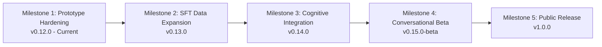

# ChakrView Technical Roadmap

## Current Status: `v0.12.0-prototype`
ChakrView has completed foundational pretraining and initial supervised fine-tuning (SFT), achieving 0.0% runaway repetition and establishing baseline bilingual conversational capability. It is currently categorized as an **Experimental Prototype** operating in internal research environments.

---

## Milestone Timeline

---

### Milestone 1: Prototype Hardening & Release Audit (Current: `v0.12.0-prototype`)
- [x] Canonical vocabulary alignment (4,096 BPE).
- [x] Zero-repetition decoding configuration (SwiGLU + RoPE + 3-gram suppression).
- [x] Independent 300-prompt blind evaluation suite (`NR006_PURE_NEURAL_RESULTS.json`).
- [x] Master technical documentation and Git LFS artifact tracking.
- [x] Continuous synchronization with remote repository.

---

### Milestone 2: SFT Expansion & Bilingual Balance (`v0.13.0` — Est: 3–5 Days)
- [ ] **Curated Hindi Expansion:** Increase Devanagari Hindi conversational corpus from 12% to 35% of total SFT tokens.
- [ ] **Multi-turn Dialogue Corpus:** Train on structured 2–4 turn context pairs to improve multi-turn coherence from 5.0% to > 25.0%.
- [ ] **Domain Synthetic Datasets:**
  - 5,000 synthetic technical explanation pairs (Python, hardware, OS).
  - 2,500 arithmetic step-by-step reasoning pairs.
- [ ] **Evaluation Gate:**
  - Strict Hindi accuracy $\ge 15.0\%$.
  - English conversational accuracy $\ge 30.0\%$.
  - Arithmetic strict accuracy $\ge 25.0\%$.

---

### Milestone 3: Cognitive Integration & Adapter Architecture (`v0.14.0` — Est: 5–7 Days)
- [ ] **Deterministic Tool Routers:** Seamless invocation of calculator and python math kernel for verified arithmetic.
- [ ] **Span-Pointer Episodic Working Memory:** Explicit memory pointer network for entity tracking across conversation turns.
- [ ] **LoRA Domain Adapters:** Lightweight low-rank adaptation heads ($r=8$) for task-specific switching (Coding vs. Hindi Creative Writing).
- [ ] **Evaluation Gate:**
  - Context retention score $\ge 40.0\%$.
  - Zero privacy regression on principled abstention benchmarks.

---

### Milestone 4: Conversational Beta Release (`v0.15.0-beta` — Est: 7–10 Days)
- [ ] Unified CLI launcher (`chakrview-chat`) with real-time streaming output.
- [ ] Streamlit/FastAPI production web interface with memory inspector panel.
- [ ] Quantized inference support (INT8 / FP8 via PyTorch native quantization).
- [ ] **Evaluation Gate:**
  - Overall strict benchmark accuracy $\ge 35.0\%$.
  - Bilingual conversational coherence $\ge 85.0\%$.
  - Zero unhandled exceptions across 1,000 automated stress queries.

---

### Milestone 5: General Availability (`v1.0.0` — Future)
- [ ] Full architectural scaling to 15M–25M parameter model variants.
- [ ] Multi-turn reinforcement learning via DPO (Direct Preference Optimization).
- [ ] Standalone open-source community release with model weights and training code.
