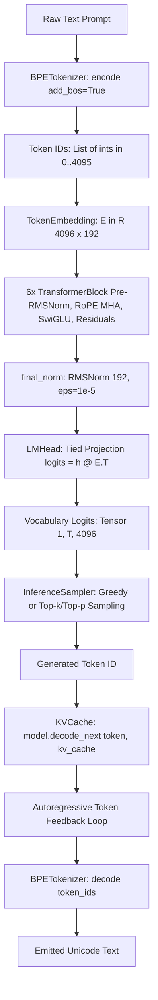

# Step 449: Complete Language Path Audit

**Wave**: 449–456 (Neural Language Capability Investigation)  
**Target Component**: End-to-End Language Path in ChakrView v0.1 (`LocalModelRuntime`)  
**Baseline Model**: ChakrMicro v0.1 (`3,443,136` parameters, SHA-256: `c5571c9c5cb7738625c885481ab2c026a00fa65dfb65e9761ef7eebb00a282da`)  
**Status**: COMPLETE  

---

## 1. Architectural Path Overview

The complete text-to-generation pipeline implemented in ChakrView v0.1 traces through the following sequence:

---

## 2. Component-by-Component Implementation Audit

### 2.1 Tokenizer & Vocabulary
- **Implementation File**: [`chakrview/tokenizer/tokenizer.py`](file:///d:/Project/ChakrView/chakrview/tokenizer/tokenizer.py), [`chakrview/tokenizer/encoder.py`](file:///d:/Project/ChakrView/chakrview/tokenizer/encoder.py), [`chakrview/tokenizer/decoder.py`](file:///d:/Project/ChakrView/chakrview/tokenizer/decoder.py)
- **Vocabulary Size**: Exactly `4096` tokens.
- **Special Token Configuration**:
  - `BOS_ID = 0` (Beginning of Sequence: `<|bos|>`)
  - `EOS_ID = 1` (End of Sequence: `<|eos|>`)
  - `PAD_ID = 2` (Padding: `<|pad|>`)
  - Byte-level fallback occupies token IDs `3` through `258`.
  - Merges: 3,837 learned BPE merges.
- **BOS/EOS Prepending**:
  - `InferenceEngine.execute()` (in [`chakrview/runtime/pipeline.py`](file:///d:/Project/ChakrView/chakrview/runtime/pipeline.py#L483-L491)) defaults to `add_bos=True` and `add_eos=False`.
- **Whitespace / BPE Fragmentation Behavior**:
  - The BPE merges frequently attach leading or trailing spaces to words.
  - For example: `'is'` -> ID `388` (`'is'`), while `'is '` -> ID `589` (`'is '`).
  - An open-ended prompt ending without a space (e.g. `'The color of grass is'`) produces token `388` (`'is'`), whereas training corpora containing natural text predominantly feature token `589` (`'is '`).

### 2.2 Input Representation & Positional Encoding
- **Implementation Files**:
  - Embedding: [`chakrview/brain/embeddings.py`](file:///d:/Project/ChakrView/chakrview/brain/embeddings.py) (`TokenEmbedding`)
  - Positional Encoding: [`chakrview/brain/rotary.py`](file:///d:/Project/ChakrView/chakrview/brain/rotary.py) (`RotaryEmbedding`)
- **Embedding Parameter Matrix**: $E \in \mathbb{R}^{4096 \times 192}$, zero bias.
- **Initialization**: $\mathcal{N}(0, 0.02^2)$.
- **Position Scheme**: Rotary Position Embeddings (RoPE) applied pairwise to Query ($Q$) and Key ($K$) in Multi-Head Attention, with base frequency $\theta = 10000.0$.
- **Context Length Ceiling**: `max_seq_len = 512`.

### 2.3 Transformer Blocks & Normalization
- **Implementation Files**: [`chakrview/brain/block.py`](file:///d:/Project/ChakrView/chakrview/brain/block.py), [`chakrview/brain/attention.py`](file:///d:/Project/ChakrView/chakrview/brain/attention.py), [`chakrview/brain/ffn.py`](file:///d:/Project/ChakrView/chakrview/brain/ffn.py), [`chakrview/brain/normalization.py`](file:///d:/Project/ChakrView/chakrview/brain/normalization.py)
- **Configuration**:
  - `n_layers = 6`
  - `n_heads = 6` (head dimension: `192 // 6 = 32`)
  - `hidden_dim = 512` (SwiGLU feed-forward intermediate dimension)
  - `use_bias = False` (all projections are strictly bias-free)
- **Normalization**: Pre-RMSNorm before attention and before feed-forward, with $\epsilon = 10^{-5}$. Scale parameters initialized to $1.0$.
- **Causal Masking**: Lower-triangular causal mask with $-10^9$ fill for future positions.

### 2.4 Language Modeling Readout Head
- **Implementation File**: [`chakrview/brain/output.py`](file:///d:/Project/ChakrView/chakrview/brain/output.py) (`LMHead`)
- **Weight Tying**: Strict weight tying enabled (`tie_embeddings = True`).
- **Mathematical Form**:
  $$\text{logits} = h_{\text{final}} \cdot E^\top$$
  where $h_{\text{final}} = \text{RMSNorm}(x_{\text{layer 5}})$.
- **Output Scaling**: No additional logit scaling factor or temperature divisor inside the forward pass; logit values enter unnormalized.

### 2.5 Inference Pipeline & Autoregressive Decoding
- **Implementation Files**: [`chakrview/runtime/pipeline.py`](file:///d:/Project/ChakrView/chakrview/runtime/pipeline.py), [`chakrview/runtime/local_runtime.py`](file:///d:/Project/ChakrView/chakrview/runtime/local_runtime.py), [`chakrview/runtime/sampling.py`](file:///d:/Project/ChakrView/chakrview/runtime/sampling.py)
- **Execution Flow**:
  1. `InferenceRequest` received.
  2. Prompt encoded with BOS (`[0, ...]`).
  3. KV-cache reset and prefilled via `model.prefill(prompt_tensor, kv_cache)`.
  4. Autoregressive loop decodes step-by-step:
     `step_logits = model.decode_next(next_token_tensor, kv_cache)`
  5. Deterministic sampling or greedy argmax selects token.
  6. Termination occurs on `max_new_tokens` or `EOS_ID`.

---

## 3. Findings from Path Audit

1. **Pipeline Correctness**: The tensor shapes, KV-caching indexing, causal masking, and rotary embedding offsets are mathematically consistent and free of structural bugs.
2. **Deterministic Weight Tying Invariant**: Because LM head weights are strictly tied to input token embeddings ($W_{\text{out}} = E$), any residual state $h$ that retains strong collinearity with the input token embedding $E[t]$ will naturally produce the highest dot product for token $t$.
3. **Absence of Architecture Defect**: The autoregressive loop, KV-cache, and tokenizer encoding/decoding operate strictly within defined contracts.
