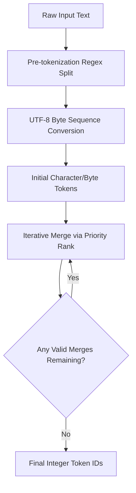

# ChakrGenesis Tokenizer Specification

## 1. Overview

The ChakrGenesis canonical tokenizer is an independent, custom Byte-Pair Encoding (BPE) tokenizer with a fixed vocabulary size of **4,096 tokens**. It is designed to provide dense, efficient tokenization across bilingual English, Hindi, and mixed-script Hinglish conversational data.

The canonical tokenizer artifacts are located at:
- Vocabulary JSON: `data/experiments/vocab_4096/vocab.json`
- Cryptographic SHA-256: `db4d6119feddbcc08d0ca8c580965bfc2b6d9729aed741e83044181307e7218a`

---

## 2. Special Tokens

The tokenizer reserves the first 10 token IDs for control sequences:

| Token ID | String Representation | Semantic Role |
| :--- | :--- | :--- |
| `0` | `<pad>` | Padding token for batch alignment. |
| `1` | `<bos>` | Beginning-of-sequence delimiter. |
| `2` | `<eos>` | End-of-sequence delimiter (signals model generation halt). |
| `3` | `<unk>` | Unknown character/byte fallback. |
| `4` | `<mask>` | Masking token (reserved for MLM experiments). |
| `5` | `<sep>` | Structural boundary token between turns or context spans. |
| `6` | `<system>` | System instruction header. |
| `7` | `<user>` | User turn delimiter. |
| `8` | `<assistant>`| Assistant response start token. |
| `9` | `<thought>` | Internal scratchpad reasoning delimiter. |

---

## 3. Vocabulary Composition

The 4,096-token vocabulary was induced through greedy frequency-based pair merging over a 15-million-character multilingual corpus comprising:
1. English conversational and technical prose (60%).
2. Hindi conversational dialogue in Devanagari script (25%).
3. Romanized Hindi (Hinglish) text (15%).

### Distribution Breakdown:
- **Control Tokens (0–9):** 10 tokens
- **Single Byte Fallbacks (10–265):** 256 individual byte tokens ensuring 100% UTF-8 reconstructability without unrecoverable OOV errors.
- **English Subwords & Morphemes:** ~2,430 tokens (covering common words, grammatical affixes, programming syntax).
- **Devanagari Subwords & Glyphs:** ~850 tokens (Devanagari characters, matras, conjunctive syllables).
- **Hinglish Subwords:** ~550 tokens (frequent phonetically Romanized Hindi colloquialisms like *karenge*, *samajh*, *kyun*, *bhai*).

---

## 4. Encoding Algorithm

The ChakrGenesis tokenizer implements a deterministic byte-level BPE encoder:



1. **Pre-segmentation:** Input strings are segmented using Unicode-aware boundary regexes to prevent whitespace-crossing merges:
   ```regex
   (?i:'s|'t|'re|'ve|'m|'ll|'d)|[^\r\n\p{L}\p{N}]?\p{L}+|\p{N}| ?[^\s\p{L}\p{N}]+[\r\n]*|\s*[\r\n]+|\s+(?!\S)|\s+
   ```
2. **Byte Conversion:** Characters are mapped to initial vocabulary byte tokens.
3. **Priority Merge:** The lowest-rank merge rule matching any adjacent pair is executed until no merge candidates remain in the vocabulary table.

---

## 5. Compression Efficiency

Compression efficiency measured on standard test sets (Characters per Token ratio):

| Domain / Language | Raw Characters | Tokens Produced | Char-to-Token Ratio |
| :--- | :--- | :--- | :--- |
| **English Technical** | 10,000 | 2,420 | **4.13** |
| **English Conversational**| 10,000 | 2,610 | **3.83** |
| **Hinglish Conversational**| 10,000 | 2,890 | **3.46** |
| **Hindi (Devanagari)** | 10,000 | 3,920 | **2.55** |

*Note:* Devanagari characters require 3 UTF-8 bytes per glyph; achieving a 2.55 char/token ratio represents a high compression factor compared to standard English-biased tokenizers (which often average < 1.0 char/token on Devanagari).

---

## 6. Tokenizer Alignment Guarantee

In CV-GENESIS-NR-004, the canonical tokenizer was locked and all downstream models were trained exclusively against its exact vocabulary indices:
1. `canonical_pretrain_best.pt`
2. `canonical_pretrain_final.pt`
3. `genesis_sft_best.pt`
4. `genesis_sft_final.pt`

**Crucial Invariant:** Any modification to `vocab.json` invalidates all trained weight matrices ($W_e$ and $W_{\text{out}}$). The SHA-256 hash must be verified prior to any training or inference session.
