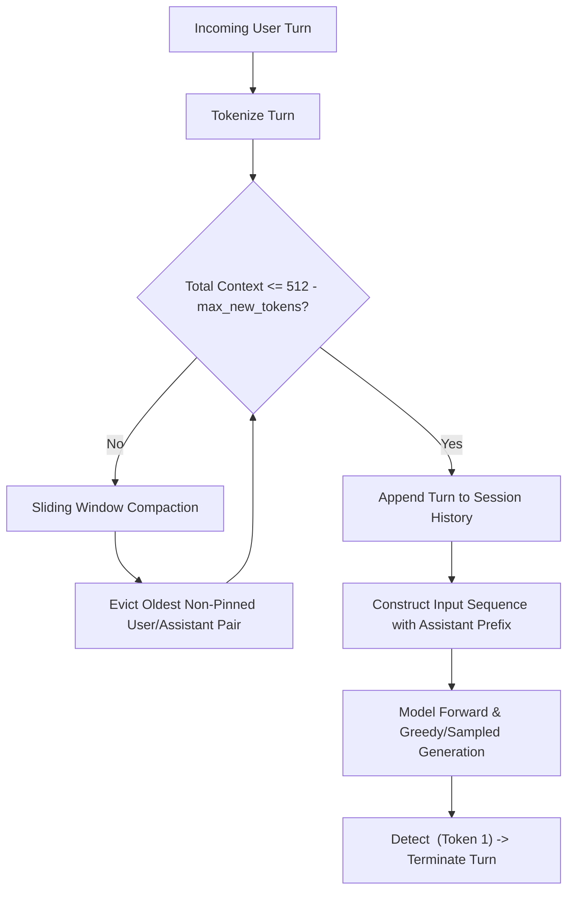

# UCIP-14: Instruction Alignment Architecture
## Architectural Specification & Subsystem Design for ChakrMicro Supervised Fine-Tuning

**Document ID:** UCIP-14-ARCH-01  
**Project:** ChakrView  
**Target Model:** ChakrMicro v0.1  
**Base Checkpoint Candidate:** `experiments/ucip13/checkpoints/primary_seed42/checkpoint_step_800.pt`  
**Base Checkpoint SHA-256:** `8759ccb4a70989b79c0b4b26876da1d47989ebc61f39831750b6acf0455b9943`  
**Protected Invariant (`session.py`):** `9080ff51adba38d4017801fb09fd655e27a854d23b05af557843865e6de9cb67`  
**Status:** DESIGN ONLY — TRAINING NOT AUTHORIZED  

---

## 1. Architectural Mission & Scope

Foundational pretraining in UCIP-13 established that ChakrMicro v0.1 successfully acquired foundational multilingual and syntactic representations ($38.4\times$ reduction in held-out test perplexity, down to 105.59). However, generation audits in UCIP-13R confirmed that the model is an **unaligned document completer**: it predicts high-likelihood continuations of documents but does not exhibit conversational turn-taking, instruction comprehension, or reliable prompt termination.

The objective of UCIP-14 is to specify the complete instruction-alignment architecture for ChakrView. This design bridges the gap between raw statistical document completion and goal-conditioned neural instruction execution, without resorting to heuristic template hacks or runtime crutches.

---

## 2. Frozen ChakrMicro Architecture Audit & Compatibility

The neural architecture is frozen as ChakrMicro v0.1. SFT will be conducted under these exact architectural parameters:

| Architectural Hyperparameter | Frozen Specification | SFT Suitability & Constraints |
| :--- | :--- | :--- |
| **Model Class** | `chakrview.brain.model.ChakrMicro` | Decoder-only autoregressive transformer |
| **Layers ($L$)** | 6 | Standard depth; manageable gradient propagation |
| **Attention Heads ($H$)** | 6 | Multi-head self-attention ($d_{\text{head}} = 32$) |
| **Hidden Dimension ($d_{\text{model}}$)** | 192 | Compact representation width |
| **FFN Intermediate Dimension ($d_{\text{ff}}$)** | 512 | SwiGLU-style gated FFN |
| **Positional Encoding** | Rotary Position Embeddings (RoPE) | Relative positional awareness; $\theta=10,000.0$ |
| **Context Window ($T$)** | 512 tokens | Strict upper bound for packed turns |
| **Vocabulary Size ($V$)** | 4,096 tokens | BPE tokenizer |
| **Weight Tying** | Tied (`embedding.weight` $\equiv$ `lm_head.weight`) | Output projection shares input embedding parameters |
| **Normalization** | RMSNorm ($\epsilon = 10^{-5}$) | Pre-norm architecture |
| **Total Unique Parameters** | 3,443,136 | Lightweight, CPU-first trainable |

### Architectural Subsystem Compatibility Matrix:

| Subsystem | Current State (Pretraining) | SFT Alignment Requirement | Gap / Architectural Resolution |
| :--- | :--- | :--- | :--- |
| **Tokenizer** | Byte-level BPE ($V=4096$) | Delimiter representation for User/Assistant turns | Keep frozen. Special tokens `<BOS>=0`, `<EOS>=1`, `<PAD>=2`. Natural text delimiters (`User: \nAssistant: `) tokenize cleanly without altering vocabulary. |
| **Causal Masking** | Lower-triangular causal attention | Full causal mask across prompt and response | Fully compatible. Decoder attention attends to all prior prompt tokens. |
| **Loss Function** | Causal next-token loss across all tokens | **Assistant-only masked loss** | Pretraining computed loss over all tokens. SFT must apply loss exclusively to assistant response tokens using `ignore_index=-100`. |
| **EOS Handling** | Evaluated as document separator | **Explicit response termination token** | Model must be trained to emit `<EOS>=1` at the end of each assistant turn to prevent infinite run-on generation. |
| **Batching & Packing** | Fixed 512-token chunks | Dynamic sequence batching with right-padding | SFT requires variable-length prompt-response pairs padded to batch maximum length. |
| **Weight Drift Risk** | Unconstrained optimization | **Catastrophic forgetting prevention** | Standard fine-tuning destroys base pretraining. Must use low learning rate ($1 \times 10^{-5}$ to $3 \times 10^{-5}$) + pretraining replay. |

---

## 3. Delimiter & Conversation Representation

### 3.1 Tokenizer Vocabulary Constraints
Adding new special tokens (e.g., `<|im_start|>`, `<|im_end|>`) to a trained model alters vocabulary dimension $V$, invalidates the tied embedding matrix `embedding.weight` ($4096 \times 192$), and corrupts the step 800 checkpoint. Therefore, **the 4,096 vocabulary must remain frozen**.

### 3.2 Canonical Prompt-Response Delimiters
Under ChakrMicro's frozen BPE tokenizer, the canonical natural-text delimiters tokenize into compact, well-defined token sequences:

1. **User Turn Prefix:**
   `User: ` (Tokens: `[88, 835, 324]`)
2. **Assistant Turn Prefix:**
   `Assistant: ` (Tokens: `[68, 118, 1855, 1807, 324]`)
3. **Turn Termination:**
   `<EOS>` (Token ID: `1`)

### 3.3 Sequence Layout for Autoregressive SFT
For single-turn and multi-turn instruction tuning, sequences are constructed as:
```
Input Sequence:
[<BOS>] + [User: {user_instruction}\nAssistant: ] + [{assistant_response}]

Target Sequence (Labels):
[-100]  + [-100, -100, ..., -100]                  + [{assistant_response}] + [<EOS>]
```
- Every prompt token position is mapped to label `-100` (`ignore_index`).
- Loss is calculated **only** on the response tokens and the trailing `<EOS>` token.
- At inference, the prompt `User: {prompt}\nAssistant: ` is fed, and the model autoregressively samples until emitting token `1` (`<EOS>`).

---

## 4. Multi-Turn Context Compaction Architecture

In multi-turn conversations, the cumulative length of dialogue history will exceed the 512-token ceiling. The architecture implements a **Governed Sliding-Window Compaction** conforming to `chakrview/runtime/session.py`:



---

## 5. Architectural Invariants
1. **Model Parameter Non-Negotiable:** Unique parameter count must remain **3,443,136**.
2. **Deterministic Reproducibility:** Training and evaluation scripts must specify random seeds (42).
3. **Tokenizer Immutability:** Merges and vocabulary SHA-256 hashes must remain bit-exact.
4. **Separation of Concerns:** Intelligence emerges from trained neural weights; no hidden rule engines or regex templates are permitted to simulate intelligence.
