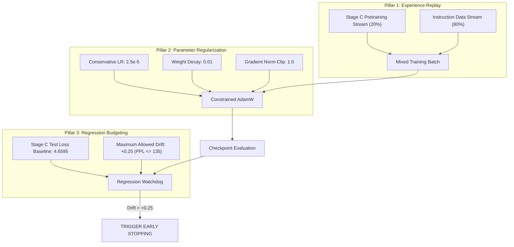

# UCIP-14: Retention and Forgetting Plan
## Preventing Foundational Degradation During Supervised Alignment

**Document ID:** UCIP-14-RET-01  
**Project:** ChakrView  
**Status:** DESIGN ONLY — TRAINING NOT AUTHORIZED  

---

## 1. The Catastrophic Forgetting Risk in ChakrMicro

ChakrMicro v0.1 has a capacity of **3.44M parameters**. In small-parameter neural language models, fine-tuning is exceptionally volatile:
- Allocating 100% of gradient updates to short, repetitive conversational templates over-indexes on conversational prefixes (`User:`, `Assistant:`), rapidly warping the attention projection weights ($W_q, W_k, W_v, W_o$) and MLP gating layers ($W_{\text{gate}}, W_{\text{up}}, W_{\text{down}}$).
- In historical experiments (e.g. UCIP-09R), this caused validation perplexity on natural text to explode from 100 to over 2,000, destroying baseline language comprehension.

---

## 2. Retention Architecture: Three-Pillar Defense

---

## 3. Pillar 1: Controlled Foundational Replay

During training, every batch of size 32 is constructed as a mixture:
- **26 sequences** from the SFT instruction dataset (processed with assistant-only causal loss).
- **6 sequences** from the Stage C pretraining corpus (processed with full causal next-token cross-entropy).

This ensures that the model continues to backpropagate gradients through general syntactic structures, Wikipedia paragraphs, Python code repositories, and Devanagari literature, preserving representations learned during pretraining.

---

## 4. Pillar 2: Constrained Optimization Regime

- **Peak Learning Rate:** Must not exceed $3.0 \times 10^{-5}$ ($16.7\times$ lower than pretraining's $5.0 \times 10^{-4}$).
- **Short Warmup:** 50 steps of linear warmup to avoid initial gradient shock.
- **Tied Weight Protection:** Loss backward must preserve the identical weight tensor between `embedding.weight` and `lm_head.weight`.

---

## 5. Pillar 3: Foundational Regression Budgets & Stop Conditions

Every checkpoint saved during SFT must be automatically evaluated on the official **Stage C Validation Partition** (2 shards, 465,954 tokens).

### Regression Limits:
| Metric | UCIP-13 Baseline (Step 800) | Maximum Allowed SFT Drift | Immediate Stop Condition |
| :--- | :---: | :---: | :---: |
| **Stage C Validation Loss** | 4.6859 | $\le 4.9359$ ($+0.25$) | $> 4.9500$ ($+0.264$) |
| **Stage C Validation Perplexity** | 108.41 | $\le 139.2$ | $> 141.0$ |
| **English Domain Test Loss** | 4.2617 | $\le 4.5500$ ($+0.288$) | $> 4.6000$ |
| **Hindi Domain Test Loss** | 4.7847 | $\le 5.0500$ ($+0.265$) | $> 5.1000$ |

If any checkpoint breaches these stop boundaries, the training run is immediately halted. The candidate checkpoint is rejected, and the run is marked as having failed the Foundational Retention Gate.
