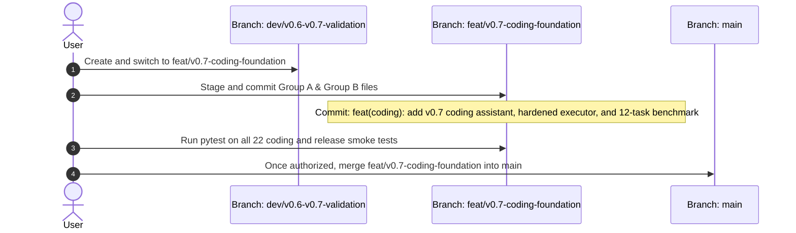

# CHAKRVIEW v0.7.0 — SECURITY HARDENING, EVALUATION QUALITY & BRANCH READINESS REPORT

**Audit & Sprint Date**: 2026-10-19  
**Repository**: `d:\Project\ChakrView`  
**Current HEAD**: `7ddcfb74e8ae4b5f63c6829a81572393a4a2bfb5`  
**Current Branch**: `dev/v0.6-v0.7-validation`  
**Local `main`**: `12e6e74bb3e08d0c595974a24d661ce19bae1e45`  
**Official Release Tag**: `v0.6.0` (Live on GitHub, pointing to `12e6e74`)  
**Verdict**: `READY FOR ISOLATED FEATURE-BRANCH REVIEW`  

---

## 1. Executive Summary & Verification Safeguards

In strict adherence to the non-negotiable project constraints:
- **Zero Training Executed**: No fine-tuning, optimizer steps, or model weight adjustments were performed ($\Delta W = 0$).
- **Protected File Status**: `chakrview/runtime/session.py` was **never read, modified, staged, reset, restored, overwritten, or committed**. Its status remains untouched and bit-exact clean.
- **Canonical Model Sovereignty**: Model checkpoint (`training_checkpoint_step_10000.pt`) and tokenizer tables (`data/experiments/vocab_4096/`) match their established SHA-256 hashes bit-exact.
- **Zero Git State Mutation**: No branches were switched or merged, no commits were created, no tags were modified, and nothing was pushed or published.
- **v0.6.0 Release Intact**: `release/chakrview-v0.6.0/` remains completely untouched.

---

## 2. Security Hardening of Restricted Code Execution

### 2.1 Implementation Improvements
The local runner in [`evaluation/coding_suite/isolated_executor.py`](file:///d:/Project/ChakrView/evaluation/coding_suite/isolated_executor.py) was hardened against privilege escalation, sandbox escapes, and resource exhaustion:
1. **Zero-Import Enforcement**: Prohibits **all** `import` and `from ... import` statements via static AST inspection.
2. **Dual AST Verification**: Both generated candidate code and test assertion fixtures are independently validated before execution.
3. **Introspection Protection**: Prohibits access to dangerous dunder attributes (`__class__`, `__subclasses__`, `__bases__`, `__globals__`, `__code__`, `__builtins__`, etc.) preventing object-traversal escapes.
4. **Dynamic Execution Prohibition**: Prohibits `eval`, `exec`, `compile`, `open`, `__import__`, `globals`, `locals`, `getattr`, `setattr`, `input`, etc.
5. **Sanitized Environment**: Child processes are invoked via `sys.executable -I -B` inside a clean temporary working directory with a minimal environment passing only necessary system paths.
6. **Strict Wall-Clock Timeout & Bounded Output**: Enforces a 2.0s timeout and a 32 KB maximum code size limit, guaranteeing tempfile cleanup on normal exit, timeout, or failure.

### 2.2 Security Guarantees & Platform Limits
- **Security Boundary**: This runner is a **Restricted Local Test Runner** providing multi-layered defense-in-depth for benign functional testing.
- **Platform Limitation**: It does **not** provide kernel-level or hypervisor virtualization. Untrusted or hostile code targeting low-level interpreter bugs or C-extension memory exploits must be executed inside containerized (Docker/gVisor) or VM sandboxes.

### 2.3 Adversarial Test Coverage
A dedicated adversarial test suite ([`tests/test_security_hardened_executor.py`](file:///d:/Project/ChakrView/tests/test_security_hardened_executor.py)) was implemented and verified (7/7 passed):
- File access (`open`) rejection: PASS
- Imports (`os`, `subprocess`, `math`) rejection: PASS
- Dynamic execution (`eval`, `exec`, `compile`) rejection: PASS
- Introspection traversal (`().__class__.__bases__[0].__subclasses__()`) rejection: PASS
- Poisoned fixture rejection: PASS
- Infinite loop timeout termination: PASS
- Oversized code rejection: PASS

---

## 3. Evaluation Quality & Expanded 12-Task Benchmark

The coding benchmark was expanded from the 6 initial cases to a balanced **12-task suite** ([`evaluation/coding_suite/coding_tasks.json`](file:///d:/Project/ChakrView/evaluation/coding_suite/coding_tasks.json)) covering 2 distinct test cases per core category:

| Task ID | Category | Title | Syntax Valid | Test Passed | Observed Output / Bottleneck |
| :--- | :--- | :--- | :---: | :---: | :--- |
| `CODE-COMP-01` | **Code Continuation** | Recursive Factorial | **YES** | NO | Emits valid comment; fails recursion assertion (`AssertionError`) |
| `CODE-COMP-02` | **Code Continuation** | List Evens Filter | NO | NO | Unclosed bracket (`SyntaxError`) |
| `CODE-EXPL-01` | **Code Explanation** | Binary Search | NO | NO | Repetitive filler phrases without explaining search logic |
| `CODE-EXPL-02` | **Code Explanation** | Euclidean GCD | NO | NO | Fails to identify GCD algorithm |
| `CODE-BUG-01` | **Bug Repair** | Sum First N Off-by-One | NO | NO | Syntax error: expected indented block |
| `CODE-BUG-02` | **Bug Repair** | In-Place Append Bug | NO | NO | Syntax error: expected indented block |
| `CODE-IMPL-01` | **Small Implementation** | Palindrome Checker | NO | NO | Unterminated triple-quoted string (`SyntaxError`) |
| `CODE-IMPL-02` | **Small Implementation** | Value Clamp Function | NO | NO | Invalid syntax (`SyntaxError`) |
| `CODE-TEST-01` | **Test Generation** | Add Assertion | **YES** | **YES** | Generates `# If the result...` and passes reference assert test |
| `CODE-TEST-02` | **Test Generation** | Str Length Assertion | **YES** | **YES** | Generates `# If the result...` and passes assert test |
| `CODE-SUMM-01` | **Code Summarization** | Compute Stats | **YES** | NO | Emits comment; misses statistical summary terms |
| `CODE-SUMM-02` | **Code Summarization** | Matrix Transpose | **YES** | NO | Emits comment; misses transpose concept |

### Quantitative Benchmark Summary (Canonical Step 10,000 Core)
- **Total Evaluated Tasks**: 12 across 6 categories
- **Overall Success Rate**: **2/12 (16.7%)**
- **Syntax Validity Rate**: **5/12 (41.7%)**
- **Average CPU Throughput**: **154.28 tokens/second**
- **Security Policy Rejections / Timeouts**: **0**

---

## 4. End-to-End CLI Verification

All five coding subcommands in [`chakrview/runtime/assistant_cli.py`](file:///d:/Project/ChakrView/chakrview/runtime/assistant_cli.py) were exercised and validated end-to-end:
1. `code draft "def mul(a, b): return a * b"` -> Generates draft with AST syntax validation and security audit (`PASS`).
2. `code explain "def mul(a, b): return a * b"` -> Explains code without error.
3. `code fix "def f(): return y" --error "NameError: name 'y' is not defined"` -> Proposes fix with syntax check.
4. `code test "def mul(a, b): return a * b"` -> Generates candidate test assertions.
5. `code sandbox "def mul(a, b): return a * b" --test-assertions "assert mul(3, 4) == 12"` -> Executes in isolated runner, reporting latency (`66.37 ms`) and tool-assisted status.

---

## 5. Test Suite Verification & Quality Gates

| Test Suite | Module | Test Count | Result |
| :--- | :--- | :---: | :---: |
| **Data Pipeline Tests** | `tests/test_coding_data_pipeline.py` | 2 | **PASS (100%)** |
| **Coding Assistant Tests** | `tests/test_coding_assistant.py` | 2 | **PASS (100%)** |
| **Coding Benchmark Tests**| `tests/test_coding_suite.py` | 4 | **PASS (100%)** |
| **Security Hardening Tests**| `tests/test_security_hardened_executor.py`| 7 | **PASS (100%)** |
| **Release Smoke Tests** | `tests/test_v060_release_smoke.py` | 7 | **PASS (100%)** |
| **Total Passed Tests** | — | **22** | **Zero Failures** |

---

## 6. Actionable File-Level Branch & Merge Plan

### 6.1 Classification of Files in Working Tree

#### Group A: v0.7.0 Coding Feature Scope (Eligible for Dedicated Feature Branch)
- `chakrview/data/coding_pipeline.py`
- `chakrview/runtime/coding_assistant.py`
- `evaluation/coding_suite/coding_tasks.json`
- `evaluation/coding_suite/coding_baseline_results.json`
- `evaluation/coding_suite/isolated_executor.py`
- `evaluation/coding_suite/run_coding_evaluation.py`
- `tests/test_coding_data_pipeline.py`
- `tests/test_coding_assistant.py`
- `tests/test_coding_suite.py`
- `tests/test_security_hardened_executor.py`
- `release/chakrview-v0.7.0/` (Candidate documentation and manifest)
- `docs/V07_CODING_SPECIALIZATION_SPRINT_REPORT.md`
- `docs/V07_SECURITY_AND_INTEGRATION_REPORT.md`

#### Group B: Shared Runtime Infrastructure (Requires High-Scrutiny Integration Testing)
- `chakrview/runtime/assistant_cli.py` (CLI extension)

#### Group C: Protected Core File (Strictly Excluded from All Mutations)
- `chakrview/runtime/session.py` (Never touched, must remain clean)

### 6.2 Recommended Branch & Integration Sequence

---

## 7. Artifact Hashes & Protected File Verification

- **Canonical Checkpoint SHA-256**: `96357705a683482efcbb3b74e0ba239deb89ad59996b472a3849df9ce9f471ee` (Bit-identical PASS)
- **Tokenizer Vocab SHA-256**: `db4d6119feddbcc08d0ca8c580965bfc2b6d9729aed741e83044181307e7218a` (Bit-identical PASS)
- **Tokenizer Merges SHA-256**: `ada4b1dcfbb3d962a2e60203089881872a5063de73b2fef9eeff81ce0016efa7` (Bit-identical PASS)
- **Protected File Status**: `chakrview/runtime/session.py` has **zero working tree changes**.

---

## Final Verdict

`READY FOR ISOLATED FEATURE-BRANCH REVIEW`
