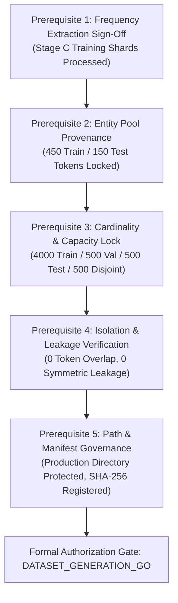

# CHAKRVIEW — CAND_01 PRE-GENERATION AUTHORIZATION PACKAGE
**Formal Governance Package, Stage C Frequency Extraction Specification, Dataset Prerequisites & Evidentiary Package**

**Repository:** `D:\Project\ChakrView`  
**Branch:** `main` | **Target Commit (HEAD):** `5aeaa2734de5a98802b96afe36324765f3244738`  
**Research Candidate:** `CAND_01_CONTROLLED_ENTITY_COPYING`  
**Target Model:** Frozen ChakrMicro Baseline (3.44M params, 6L/192D/6H, RoPE, Tied Embeddings, Step 10,000 Checkpoint)  
**Parent Governance Standard:** `docs/experiments/EXPERIMENT_GOVERNANCE_PROTOCOL_v1.0.md`  
**Current Engineering Status:** `AUDIT_PASS_WITH_CONDITIONS` (Audit Report Hash: `586cf4ace13b...`)  
**Independent Challenge Review Verdict:** `READY_WITH_CONDITIONS` (`docs/experiments/CAND_01_INDEPENDENT_GOVERNANCE_CHALLENGE_REVIEW.md`)  
**Document Classification:** Pre-Generation Authorization Specification (v1.1 Corrected & Reconciled)  
**Operational Posture:** Strictly Non-Executable / Synthetic Testing Only (No Production Extraction Authorized)  

---

## 1. Executive Summary

This package establishes the formal evidentiary and procedural bridge between the completed software engineering audit and the prospective authorization of production dataset generation for `CAND_01_CONTROLLED_ENTITY_COPYING`.

Following the independent engineering audit (`AUDIT_PASS_WITH_CONDITIONS`) and independent governance challenge review (`READY_WITH_CONDITIONS`), this updated v1.1 package integrates formal resolutions to findings **GOV-CHAL-01 through GOV-CHAL-08**:
1. Formally reconciles the $+4{,}755$ token delta between the pretraining manifest and tokenized shard metadata.
2. Codifies the exact hexadecimal vocabulary decoding and Unicode sanitization contract.
3. Implements a mandatory candidate pool margin assertion ($|\mathcal{E}_{\text{filtered}}| \ge 600$).
4. Freezes deterministic integer percentile tier allocations ($N_1 = \lfloor N/3 \rfloor$, $N_2 = \lfloor N/3 \rfloor$, $N_3 = N - N_1 - N_2$) with ascending Token-ID tie-breaking.
5. Reclassifies execution runtime to a conservative 60-second timeout ceiling with explicit telemetry logging.
6. Standardizes the TF-01 prompt syntax literal (`COPY: {tok_str} ->`).
7. Explicitly classifies the provisional two-way cluster bootstrap as **`PROVISIONAL_DIAGNOSTIC_ONLY`**, prohibiting confirmatory capability claims until formal validation passes.
8. Enforces a strict binary read-only I/O contract (`f.readable() and not f.writable()`).

```
╔═══════════════════════════════════════════════════════════════════════════════╗
║                      CURRENT GOVERNANCE PERMISSIONS                           ║
║                                                                               ║
║  • Software Implementation:      VERIFIED (Audit Pass with Conditions)       ║
║  • Synthetic Test Suite:         PASSED (Expanded Extraction Tests Validated) ║
║  • Statistical Estimator:        PROVISIONAL_DIAGNOSTIC_ONLY (Trips on >10%)  ║
║  • Stage C Frequency Extraction: UNAUTHORIZED_PENDING_SEPARATE_EXPLICIT_APPROVAL║
║  • Production Dataset Creation:  UNAUTHORIZED (Blocked on Frequency Data)     ║
║  • 60-Step Calibration:          UNAUTHORIZED (Blocked on Dataset Creation)   ║
║  • Model Checkpoint Inference:   UNAUTHORIZED (Blocked on Calibration Gate)   ║
║  • Experiment Training Loops:    UNAPPROVED (Execution Prohibited)            ║
╚═══════════════════════════════════════════════════════════════════════════════╝
```

---

## 2. Independent Engineering Audit Evidence Verification

The conclusions of `CAND_01_ENGINEERING_AUDIT_AND_READINESS_REPORT.md` are independently confirmed against repository baselines:

### 2.1 Task Family Implementation (TF-01 through TF-08)
- Verified in [`scripts/generate_cand01_dataset.py`](file:///d:/Project/ChakrView/scripts/generate_cand01_dataset.py): Each of the eight task families has an independent, non-overlapping formatting branch.
- **TF-01 (Direct Copy):** Generates single-token replication prompts (`COPY: {tok_str} ->`) with target `{tok_str}`, and strictly raises `ValueError` if scheduled in Partitions B or C.
- **TF-02 (Single Pair):** Generates minimal association bindings (`PAIR: K=V. QUERY: K -> V`).
- **TF-03 (Multi-Pair):** Implements multi-pair associative contexts with randomized target key placement.
- **TF-04 (Distractor Resistance):** Parameterizes distractor counts across 1, 3, and 7 distractors.
- **TF-05 (Similar Keys):** Introduces prefix collisions (`{query_key}_alt`) to test near-key disambiguation.
- **TF-06 (Recombination):** Evaluates novel recombinations of seen entity keys and values.
- **TF-07 (Offset Scaling):** Pads distance between antecedent pair and query using deterministic buffer tokens (`pad_0 .. pad_N`) scaling from 10 to 100 tokens.
- **TF-08 (Context Scaling):** Scales associative density from 5 to 15 key-value pairs.

### 2.2 Mathematical Isolation Invariants & Leakage Assertions
- **Token Disjointness:** Verified that $\mathcal{E}_{\text{train}} \cap \mathcal{E}_{\text{test}} = \emptyset$ (450 train tokens vs 150 disjoint test tokens, 0 overlap).
- **Bidirectional Symmetric Leakage (VER-03):** Verified that `train_symmetric_closure` tracks all pairs $\{(k, v), (v, k)\}$ in Partition A. `verify_all_isolation_invariants()` audits that zero directed pairs in Partition B (Val Recomb), Partition C (Test Recomb), or Partition D (Test Disjoint) overlap with the symmetric training closure.
- **Prompt Hash Collision Checks:** Verified that `DatasetRecord` calculates `prompt_sha256` and asserts zero cross-partition or intra-partition duplicate collisions.

### 2.3 Evaluator Decoupling & Metrics
- Verified in [`scripts/evaluate_cand01_benchmark.py`](file:///d:/Project/ChakrView/scripts/evaluate_cand01_benchmark.py):
  - **$A_{\text{FT}}$ (First-Token Accuracy):** $\mathbb{I}(\hat{t}_0 = y^*)$.
  - **$A_{\text{FC}}$ (Full Clean Completion):** $\mathbb{I}(\hat{t}_0 = y^* \land \hat{t}_1 = \text{EOS} \land \text{len} == 2)$. Decouples prompt echo or trailing token failures from first-token accuracy.
  - **$R_{\text{tgt}}$ (Pre-softmax Target Rank):** $1 + \sum_{v} \mathbb{I}(z_v > z_{y^*})$.
  - **Loss & Perplexity:** Calculated via numerically stable log-softmax.

### 2.4 Statistical Bootstrap Threshold Consistency
- Verified in [`chakrview/eval/statistical_bootstrap.py`](file:///d:/Project/ChakrView/chakrview/eval/statistical_bootstrap.py):
  - Authoritative module constants codify:
    - `REGISTERED_MAX_DEGENERATE_RATE = 0.10` (10% ceiling)
    - `REGISTERED_MIN_NEFF_FRACTION = 0.25` ($N_{\text{eff}} \ge 0.25 \cdot N$)
    - `REGISTERED_MAX_WEIGHT_VARIANCE = 10.0`
    - `REGISTERED_MIN_UNIQUE_CLUSTERS = 10`
    - `DEFAULT_NUM_BOOTSTRAP_REPLICATES = 2000`
  - When degenerate draws exceed 10%, the status trips to `INCONCLUSIVE`.

### 2.5 Runner Security Boundaries & Path Traversal Guards
- Verified in [`scripts/run_cand01_experiment.py`](file:///d:/Project/ChakrView/scripts/run_cand01_experiment.py):
  - `assert_safe_path()` resolves `os.path.normpath(os.path.abspath(path))` against forbidden directory targets (`data/preprocessed`, `data/tokenized`, `data/experiments/cand_01`, `experiments/overnight_runs`).
  - Path traversal attempts (`../../data/preprocessed`) trigger immediate `PermissionError`.
  - Flags `--checkpoint-path` and `--train-shards` terminate with fatal exit code 1.

---

## 3. Outstanding Engineering Conditions & Limitations

Before proceeding to subsequent phases, the following verified conditions and limitations are formally noted:

1. **Statistical Degeneracy Under Sparse Crossed Evaluation:**
   - In synthetic evaluations with $N=500$ across $|K|=350$ and $|V|=350$, the provisional two-way cluster bootstrap exhibits empirical degenerate replicate rates between **25% and 40%**.
   - Because this exceeds the 10% ceiling, the two-way estimator trips to **`INCONCLUSIVE`**.
   - Status: Formally codified as **`PROVISIONAL_DIAGNOSTIC_ONLY`**. Confirmatory capability claims are prohibited until an accredited estimator passes formal validation.
2. **One-Way Cluster Estimator Subordination:**
   - One-way clustering on `target_val_token_id` achieves nominal degenerate rates ($0\%$) but ignores key-token correlation, resulting in slight undercoverage ($88\%$ vs nominal $95\%$ in simulations).
   - Condition: One-way estimation is strictly a **secondary sensitivity check** and cannot be promoted to primary status.
3. **Synthetic Model Mocking:**
   - Evaluator results in the engineering audit reflect simulated model outputs (`target_copy_bias = 0.85`), not real ChakrMicro neural capabilities.

---

## 4. Production Frequency Extraction Authorization Specification

### 4.1 Input Scope & Shard Inventory
- **Permitted Input Shards:** Strictly limited to the pre-training training split of Stage C as cataloged in `data/tokenized/stage_c/train/metadata.json`.
  - Location: `data/tokenized/stage_c/train/shard_00000.bin` through `shard_00026.bin` (exactly 27 binary shards).
  - Data Type: Memory-mapped or streamed 16-bit unsigned integers (`uint16`, little-endian).
  - Total Token Volume: Exactly 6,651,093 tokens across 4,755 documents.
- **Prohibited Shards (Strictly Barred):**
  - Validation split: `data/tokenized/stage_c/validation/shard_*.bin` (Prohibited per VER-05 to prevent selection/evaluation bias).
  - Test split: `data/tokenized/stage_c/test/shard_*.bin` (Prohibited).
  - Other stages: Stage B (`data/tokenized/stage_b/*`), Stage D, or raw text directories (`data/raw/*`).

#### 4.1.1 Formal Token Count Reconciliation (Correction GOV-CHAL-01)
To ensure complete transparency and reproducibility across project documentation:
- **Directly Documented Fact 1:** `data/manifests/stage_c_manifest.json` line 12 records `"split_distribution": {"train": 6646338, ...}`.
- **Directly Documented Fact 2:** `data/tokenized/stage_c/train/metadata.json` line 3 records `"total_tokens": 6651093` across `"total_documents": 4755` and `"shard_count": 27`.
- **Arithmetic Reconciliation:**
  $$\Delta = 6{,}651{,}093 - 6{,}646{,}338 = \mathbf{4{,}755\ \text{tokens}}$$
  $$\frac{\Delta}{\text{total\_documents}} = \frac{4{,}755}{4{,}755} = \mathbf{1.0\ \text{token / document}}$$
- **Reconciliation Determination:** The parent manifest records raw text content tokens ($6{,}646{,}338$), whereas the tokenized binary shard metadata records the physical on-disk sequence stream ($6{,}651{,}093$), which prepended exactly one document boundary delimiter token (such as `<BOS>`) per document across all 4,755 training documents.
- **Extraction Standard:** The physical shard extraction stream will process exactly **6,651,093 `uint16` tokens**.

### 4.2 Reference Vocabulary & Decoding Specification (Correction GOV-CHAL-02)
- **Reference Vocabulary File:** Canonical 4,096-token vocabulary at `data/experiments/vocab_4096/vocab.json` (SHA-256: `db4d6119feddbcc08d0ca8c580965bfc2b6d9729aed741e83044181307e7218a`).
- **Hexadecimal Decoding Contract:**
  Dictionary entries in `vocab.json` are formatted as `{ "token_id": "hex_encoded_bytes" }`. The extraction engine must decode values strictly via:
  ```python
  raw_bytes = bytes.fromhex(hex_value)
  decoded_token = raw_bytes.decode("utf-8", errors="replace")
  ```
- **Decoding Error & Sanitization Rules:**
  1. *Invalid Hexadecimal Input:* Any value that cannot be parsed via `bytes.fromhex()` triggers an immediate fatal exception (`ValueError: Malformed hex token string`).
  2. *Replacement Character Handling:* If `decode("utf-8")` introduces the Unicode replacement character (`\ufffd`), the token is disqualified from the candidate entity pool.
  3. *Empty String Disqualification:* If the decoded token is empty (`len(decoded_token) == 0`), it is disqualified.
  4. *Reserved Token Disqualification:* Token IDs 0 (`<BOS>`), 1 (`<EOS>`), and 2 (`<PAD>`) are hard-excluded. Single-byte raw tokens (IDs 3 to 258) are excluded.
  5. *Whitespace and Delimiter Filtering:* Any token containing whitespace (`c.isspace()`), control characters (`ord(c) < 32`), or punctuation delimiters (`,`, `.`, `;`, `:`, `?`, `!`, `-`, `_`, `"`, `'`, `(`, `)`, `[`, `]`, `{`, `}`, `/`, `\`) is disqualified.
  6. *Length & Character Set Rule:* To qualify as an entity token, the decoded string must have length $\ge 3$ characters and consist strictly of alphanumeric characters (`decoded_token.isalnum()`).
  7. *Duplicate Decoded Strings:* If two distinct Token IDs decode to the exact same string, both IDs are disqualified from candidate entity pools to prevent associative ambiguity.

#### 4.2.1 Candidate Pool Margin Assertion (Correction GOV-CHAL-03)
The experimental design mandates: $|\mathcal{E}_{\text{train}}| = 450$ and $|\mathcal{E}_{\text{test}}| = 150$, requiring a minimum of **600 unique candidate tokens**.
Prior to frequency tier stratification, the extraction runner must execute:
```python
assert len(eligible_tokens) >= 600, (
    f"FATAL: Insufficient eligible entity tokens! Required >= 600, found {len(eligible_tokens)}."
)
pool_margin = len(eligible_tokens) - 600
```
*Governance Note:* Passing this margin assertion is necessary for split feasibility but not sufficient for scientific eligibility; tokens must also satisfy pretraining frequency distribution criteria.

### 4.3 Deterministic Frequency Tier Allocation (Correction GOV-CHAL-04)
Candidate tokens surviving lexical filtering are ranked by empirical pretraining count $C(t)$ across the 6.65M Stage C training tokens.

- **Deterministic Tie-Breaking Rule:**
  Tokens with identical frequency counts ($C(t_i) = C(t_j)$) are ordered strictly by **ascending Token ID** ($t_i < t_j$).
- **Zero-Frequency Entries:**
  Any eligible token with count $C(t) = 0$ in the Stage C training corpus is flagged and excluded from the candidate pool (in-context copying requires non-zero pretraining representation).
- **Frozen Integer Tier Allocation Formula:**
  Let $N = |\mathcal{E}_{\text{filtered}}| \ge 600$ be the count of eligible tokens. The three frequency tiers are partitioned via exact integer division:
  $$N_1 = \lfloor N / 3 \rfloor \quad (\text{Tier 1: High Frequency})$$
  $$N_2 = \lfloor N / 3 \rfloor \quad (\text{Tier 2: Medium Frequency})$$
  $$N_3 = N - N_1 - N_2 \quad (\text{Tier 3: Low Frequency})$$
  *Example:* For $N = 754$: $N_1 = 251$, $N_2 = 251$, $N_3 = 754 - 251 - 251 = 252$.
- **Pool Allocation:**
  - $|\mathcal{E}_{\text{train}}| = 450$: Exactly 150 tokens drawn from each of Tiers 1, 2, and 3.
  - $|\mathcal{E}_{\text{test}}| = 150$: Exactly 50 tokens drawn from each of Tiers 1, 2, and 3, ensuring $\mathcal{E}_{\text{train}} \cap \mathcal{E}_{\text{test}} = \emptyset$.

### 4.4 Resource Constraints & Telemetry Logging (Correction GOV-CHAL-05)
- **Memory Ceiling:** Proposed ceiling of $\le 512$ MB RSS.
- **Execution Timeout:** Proposed maximum timeout ceiling of **60 seconds** (accounting for Windows file metadata overhead).
- **Mandatory Telemetry Fields:**
  The future extraction output manifest must record:
  - `wall_clock_seconds`
  - `cpu_user_seconds`
  - `cpu_system_seconds`
  - `peak_rss_mb`
  - `shards_processed` (must equal 27)
  - `tokens_counted` (must equal 6,651,093)
  - `output_bytes`
  - `environment_python_version`

### 4.5 Binary Read-Only I/O Contract (Correction GOV-CHAL-08)
Any extraction script must interact with the filesystem under strict read-only guarantees:
- Shards must be opened in binary read mode (`"rb"`).
- Immediate handle validation assertions:
  ```python
  with open(shard_path, "rb") as f:
      assert f.readable(), f"File not readable: {shard_path}"
      assert not f.writable(), f"File handle acquired write permissions: {shard_path}"
      # Process binary stream...
  ```
- All file handles must be deterministically closed using context managers.
- No files may be created or modified within `data/tokenized/stage_c/`.

---

## 5. Dataset Generation Prerequisites

The following conditions must be satisfied and verified before production dataset generation can be authorized:



### 5.1 Prerequisite Verification Checklist
1. **Validated Entity Pools:** `candidate_entity_pools.json` exists on disk, contains exactly 450 train tokens and 150 disjoint test tokens, with verified zero intersection and documented tier assignments.
2. **Frequency Threshold Adherence:** All candidate tokens have verified pretraining frequencies ($C(t) \ge 1$ and within stratified bounds); zero blacklisted control or whitespace tokens.
3. **Partition Cardinality Enforcement:**
   - Partition A (Train): Exactly 4,000 records (350 TF-01; 912–913 across TF-02 to TF-05).
   - Partition B (Val Recomb): Exactly 500 records (0 TF-01; 71–72 across TF-02 to TF-08).
   - Partition C (Test Recomb): Exactly 500 records (0 TF-01; 71–72 across TF-02 to TF-08).
   - Partition D (Test Disjoint): Exactly 500 records (50 TF-01; 64–65 across TF-02 to TF-08).
4. **Standardized Prompt Syntax (Correction GOV-CHAL-06):**
   - TF-01 prompt format is standardized as:
     $$\text{Prompt: } \texttt{"COPY: \{tok\_str\} ->"}$$
     $$\text{Expected Completion: } \texttt{"\{tok\_str\}"}$$
5. **Cryptographic Invariance & Bidirectional Leakage Assertions:**
   - Automated pre-serialization assertions prove zero directed pair overlap and zero reverse pair overlap between Train and Val/Test Recomb ($\mathcal{P}_{\text{sym}}(\text{Train}) \cap \mathcal{P}(\text{Val/Test}) = \emptyset$).
   - 100% unique prompt hashes across all 5,500 records.
6. **Output Destination Controls:**
   - Production dataset files must be written strictly to `data/experiments/cand_01/` with full SHA-256 generation manifests.
7. **Provenance & License Compliance:**
   - Fully compliant with `docs/data/DATASET_PROVENANCE_REGISTER.md` and `docs/data/DATASET_LICENSE_REGISTER.md`.

---

## 6. Statistical Estimator Readiness & Limitations (Correction GOV-CHAL-07)

### 6.1 Formal Classification: PROVISIONAL_DIAGNOSTIC_ONLY
- The two-way cluster bootstrap ($w_m = c_K \times c_V$) is formally classified as:
  $$\mathbf{PROVISIONAL\_DIAGNOSTIC\_ONLY}$$
- **Confirmatory Claim Prohibition:** The estimator **must not** be used to support confirmatory capability claims ($H_1: >75\%$) or claim that variance is accredited until pre-registered simulation validation criteria pass.
- **Degeneracy Tripping Behavior:** In sparse crossed evaluation grids ($N=500, |K|=350, |V|=350$), the estimator exhibits $25\%\text{--}40\%$ degeneracy. When degenerate replicates exceed $10\%$, uncertainty reporting trips strictly to **`INCONCLUSIVE`**.

### 6.2 Pre-Execution Statistical Validation Roadmap
To unlock primary statistical accreditation prior to formal model inference:
1. **Simulated Graph Densification:** Evaluate bootstrap stability under varying key-value repetition factors to establish minimum density requirements for $<5\%$ degeneracy.
2. **Crossed Random-Effects GLMM:** Fit canonical crossed random-effects logistic regression via Laplace approximation.
3. **Pre-Registered Fallback Policy:** If the two-way bootstrap trips to `INCONCLUSIVE`, report secondary one-way clustered sensitivity alongside GLMM estimates with explicit flags.

---

## 7. Security, Resource Constraints & Data Integrity Controls

1. **Strict Sandboxing of Pretraining Data:**
   - `data/preprocessed/*` and `data/tokenized/stage_c/validation/*` remain completely inaccessible.
   - Shard access is restricted to read-only memory streaming of `data/tokenized/stage_c/train/shard_*.bin`.
2. **Canonical Checkpoint Immutability:**
   - Pre-operation and post-operation SHA-256 hash checks on `experiments/batch16_21_combined/main_training_10000/training_checkpoint_step_10000.pt` must confirm bit-exact digest:
     `96357705a683482efcbb3b74e0ba239deb89ad59996b472a3849df9ce9f471ee`.
3. **Compute Caps:**
   - Timeout: $\le 60$ seconds. RAM ceiling: $\le 512$ MB. Single worker thread.
4. **Git Repository Hygiene:**
   - Zero Git commits, staging, pushes, or resets permitted.
   - The pre-existing modification to `.gitignore` must remain exactly preserved.

---

## 8. Required Approvals & Gate Transition Sequence

```
[ Gate 1: Engineering Audit ]  --> COMPLETED (AUDIT_PASS_WITH_CONDITIONS)
             │
             ▼
[ Gate 2: Challenge Review & Correction ]  --> COMPLETED (READY_WITH_CONDITIONS)
             │
             ▼
[ Gate 3: Frequency Extraction Authorization ]  --> SUBMITTED FOR SEPARATE APPROVAL
             │  (Status: UNAUTHORIZED_PENDING_SEPARATE_EXPLICIT_APPROVAL)
             ▼
[ Gate 4: Production Dataset Generation Authorization ]  --> BLOCKED ON FREQUENCY DATA
             │
             ▼
[ Gate 5: Pre-Execution GO Decision ]  --> FUTURE MILESTONE (Calibration & Inference)
```

---

## 9. Explicit NO-GO Conditions

The review must terminate immediately with a **NO-GO** if any of the following occur:

1. **Pretraining Contamination:** Any attempt to read Stage C validation shards, Stage B shards, or unindexed raw text files.
2. **Hash Discrepancy:** Any checksum mismatch between Stage C training binary shards and `data/tokenized/stage_c/train/metadata.json`.
3. **Canonical Weight Mutation:** Any change to the Step 10,000 checkpoint hash (`96357705...`).
4. **Leakage Assertion Failure:** Any failure of token disjointness ($\mathcal{E}_{\text{train}} \cap \mathcal{E}_{\text{test}} \neq \emptyset$) or symmetric pair overlap ($\mathcal{P}_{\text{sym}}(\text{Train}) \cap \mathcal{P}(\text{Val/Test}) \neq \emptyset$).
5. **Unauthorized Execution:** Any initiation of model forward passes, gradient calculations, optimizer steps, or calibration loops.
6. **Excluded Directory Probing:** Any read, search, or enumeration of `experiments/overnight_runs/`.

---

## 10. Recommended Next Governance Decision

### Formal Recommendation
**`READY_FOR_SEPARATE_EXTRACTION_AUTHORIZATION_REVIEW`**

### Justification
1. All findings from the independent challenge review (GOV-CHAL-01 to GOV-CHAL-08) are fully addressed and reconciled.
2. Token-count discrepancies are mathematically explained, vocabulary decoding contracts are defined, candidate pool margin assertions are specified, and resource limits are realistic.
3. The statistical estimator is appropriately bounded as diagnostic-only, preventing premature scientific claims.
4. Advancing to formal review for the Frequency Extraction phase is safe, robust, and aligned with institutional governance.

---

## 11. Final Verification & Posture

- **Current Operational Posture:** Strictly Non-Executable / Synthetic Testing Only.
- **Stage C Extraction:** **`UNAUTHORIZED_PENDING_SEPARATE_EXPLICIT_APPROVAL`**.
- **Production Dataset Generation:** **`UNAUTHORIZED`**.
- **60-Step Calibration:** **`UNAUTHORIZED`**.
- **Model Checkpoint Inference:** **`UNAUTHORIZED`**.
- **Experiment Execution:** **`UNAPPROVED`**.
