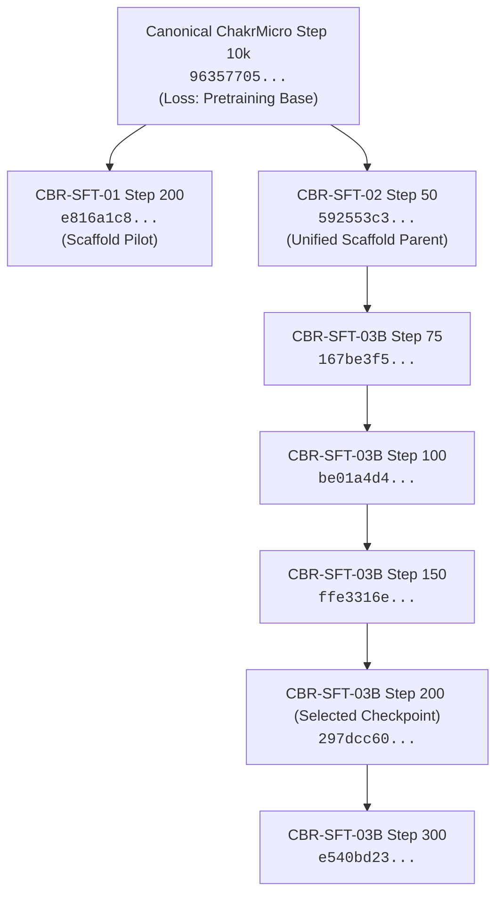

# CBR-SFT-03B — Checkpoint Lineage & Integrity Registry

## 1. Lineage Graph

---

## 2. Cryptographic Checkpoint Registry

All checkpoints were generated under isolated training conditions and verified via SHA-256:

| Checkpoint Name | Step | File Size (Bytes) | SHA-256 Hash | Status / Designation |
|---|---|---|---|---|
| `canonical_step_10000.pt` | 10000 | 41,399,761 | `96357705a683482efcbb3b74e0ba239deb89ad59996b472a3849df9ce9f471ee` | Protected Pretraining Base |
| `sft_checkpoint_step_50.pt` (CBR-02) | 50 | 41,404,343 | `592553c3e27b654997e8f5df61e94fe1de25bbf577391df6c1a87f974730bf9d` | Experimental Parent Checkpoint |
| `sft_checkpoint_step_75.pt` | 75 | 41,406,523 | `167be3f51cc924df91093109df92197d4bc14f73f0a3acf437286024b0e9cb89` | Checkpoint (Intermediate) |
| `sft_checkpoint_step_100.pt` | 100 | 41,408,994 | `be01a4d4fc23affab0259b3b8e465062e5689b4627a3e80a7bb8157df2384292` | Checkpoint (First Attractor Break) |
| `sft_checkpoint_step_125.pt` | 125 | 41,411,170 | `9fde8ed1ac7b72ed819e7f9352ef88fab13f3802c67dec4cc6453e1595a917d9` | Checkpoint (Intermediate) |
| `sft_checkpoint_step_150.pt` | 150 | 41,413,410 | `ffe3316e9c53cf526230d6d0812e7704dfce62ac5524f1d3f65973766da99906` | Checkpoint (Conversational Engagement) |
| `sft_checkpoint_step_175.pt` | 175 | 41,415,586 | `280804becaba55753c26cbac987ccfaa4fb3c1d260d0d90f972b6a594b4434fe` | Checkpoint (Intermediate) |
| `sft_checkpoint_step_200.pt` | 200 | 41,417,762 | `297dcc60f39cadd6bae9a5bd969b1a7d831845d7a67823b30c194a67ef75b5ac` | **Primary Experimental Checkpoint** |
| `sft_checkpoint_step_225.pt` | 225 | 41,419,938 | `cc4795e8c0fbc525bf3c715b0dd769d5b9f3327fe943aaf9eb0627882fe8fd34` | Checkpoint (Intermediate) |
| `sft_checkpoint_step_250.pt` | 250 | 41,422,114 | `ab654f92a67cc8977841789c62a07bde970620ec418e26dc4129ee73a1c86afd` | Checkpoint (Intermediate) |
| `sft_checkpoint_step_275.pt` | 275 | 41,424,354 | `4360d12b3a60a350bd67c662533401b8041ab7c6122ec118f46a35186957301f` | Checkpoint (Intermediate) |
| `sft_checkpoint_step_300.pt` | 300 | 41,426,594 | `e540bd2364113d7eaf271c3495d882921f4421e59659f19f06cd7d590f74710a` | Checkpoint (Final / High-Syntax Candidate) |

---

## 3. Storage Location & Integrity Verification

- Checkpoint Directory: `experiments/cbr01_sft/runs/cbr_sft_03b/`
- All checkpoints contain state dictionaries strictly adhering to canonical ChakrMicro dimensions:
  - `vocab_size`: 8192
  - `hidden_size`: 512
  - `num_layers`: 6
  - `num_heads`: 8
  - `seq_len`: 512
- No model weights in historical directories (`experiments/batch*`, `checkpoints/stage_*`, `checkpoints/experiments/*`) were modified or overwritten.
