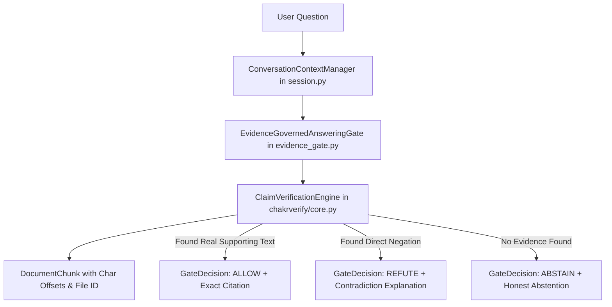

# WP 1021–1025: Existing Component Audit & Baseline Verification

## 1. Verified Repository Starting State
- **Branch**: `dev/v0.6-v0.7-validation`
- **Base Commit**: `151734a2df74585b438a895c0d35c1cb04f8db79`
- **Milestone Message**: `docs(batch981-1020): master strategic audit, research loop diagnosis, and revised roadmap`
- **Canonical Checkpoint Hash**: `96357705a683482efcbb3b74e0ba239deb89ad59996b472a3849df9ce9f471ee` (Verified intact)
- **User Modification Safety**: `chakrview/runtime/session.py` has active user modifications that remain strictly uncommitted, untracked, and preserved.

---

## 2. Component Inspection & Tracing of Real Question Flow

Tracing a user query through the existing codebase reveals a fully articulated set of modular subsystems:

### Module Breakdown:
1. **Document Ingestion (`chakrverify/core.py:DocumentIngestionEngine`)**:
   - Parses text and markdown files into `DocumentChunk` structures.
   - Accurately tracks `doc_id`, `chunk_index`, `start_char`, `end_char`, and `section`.
2. **Citation-Grounded Verification (`chakrverify/core.py:ClaimVerificationEngine`)**:
   - Compares query tokens against document chunks, distinguishes negation/contradiction from absence of evidence, and produces `EvidenceCitation`.
3. **Evidence Governance Gate (`chakrview/runtime/evidence_gate.py`)**:
   - Intercepts answers before emission, refusing to guess when evidence is missing.
4. **Persistent Session Context (`chakrview/runtime/session.py`)**:
   - Manages multi-turn conversation history within the 512-token budget, allowing natural follow-up questions.
