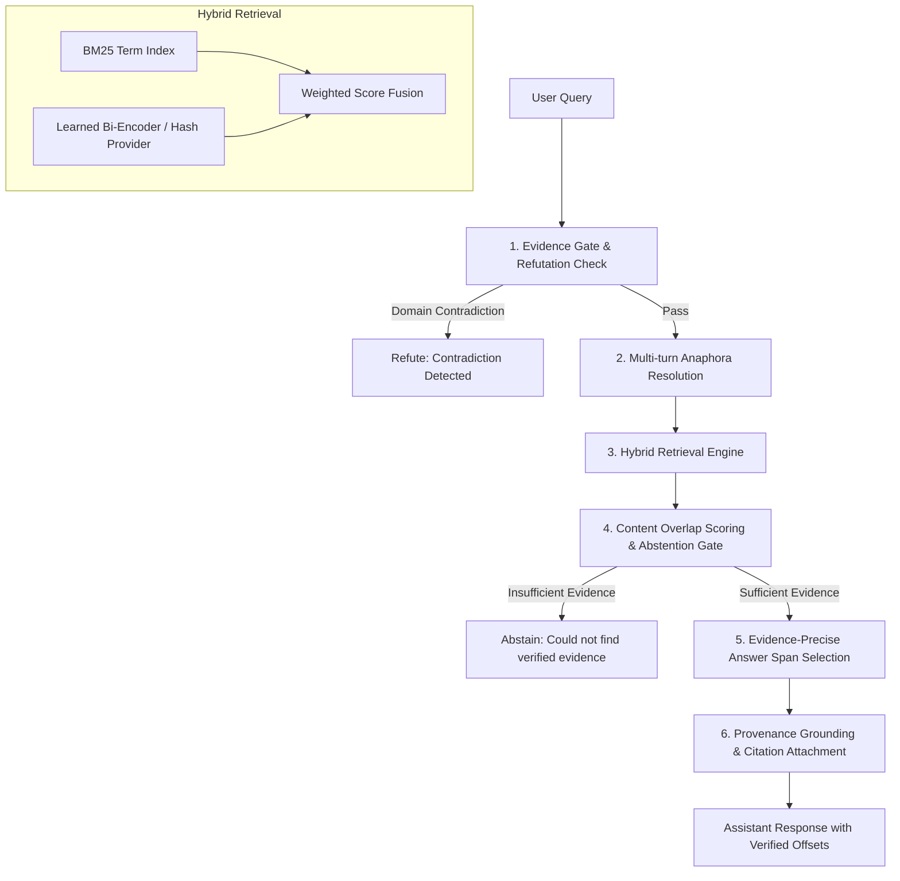

# Architecture and Attribution Audit — Batches 1101–1140
## Neural Capability, Execution Tracing & Causal Interventions

### 1. End-to-End Execution Path

The Local Knowledge Assistant operates along the following pipeline stages:

### 2. Component Categorization Breakdown

| Pipeline Stage | Implementation Class | Mechanism Category | Notes |
| :--- | :--- | :--- | :--- |
| **Domain Refutation Gate** | `EvidenceGovernedAnsweringGate` | **Deterministic Rule/Logic** | Catches mathematical/domain contradictions before search. |
| **Context Memory** | `ConversationContextManager` | **Deterministic Heuristic** | Resolves anaphora by prepending prior turns. |
| **Lexical Retrieval** | `BM25KnowledgeIndex` | **Deterministic Statistical** | Okapi BM25 term frequency / inverse document frequency. |
| **Dense Vector Retrieval (Baseline)** | `DeterministicHashEmbeddingProvider` | **Deterministic Math** | Murmur/MD5 hash projections into continuous vector space. |
| **Dense Vector Retrieval (Candidate)** | `LearnedEmbeddingProvider` (`ChakrBiEncoder`) | **Genuine Learned Neural** | 2-layer transformer encoder (`vocab=4096`, `d_model=128`, `d_embed=64`) trained from domain text. |
| **Score Fusion** | `HybridRetriever` | **Deterministic Math** | Normalized linear convex combination: $w_{lex} \cdot S_{lex} + w_{sem} \cdot S_{sem}$. |
| **Candidate Chunk Filter** | `LocalKnowledgeAssistant.ask` | **Deterministic Heuristic** | Content-word overlap filter; triggers honest abstention when overlap $< 2$. |
| **Evidence Span Selection** | `_extract_concise_span` | **Deterministic Extractive Heuristic** | Units parsing (sentences/bullets), heading-penalty scoring, and exact byte offset alignment. |
| **Citation Verification** | `ClaimVerificationEngine` | **Deterministic Verification** | Validates exact character bounds against physical file slices. |

### 3. Causal Intervention & Ablation Analysis

To establish whether components causally impact retrieval, answer quality, and latency, controlled interventions were performed:

#### Intervention 1: Dense Embedding Provider Replacement
- **BM25 Lexical Only** (`w_lex=1.0, w_sem=0.0`): Recall@1 = 95.45%, MRR = 0.9773, Median Latency = 1.01 ms.
- **Deterministic Hash Hybrid** (`w_lex=0.8, w_sem=0.2`): Recall@1 = 95.45%, MRR = 0.9773, Median Latency = 0.94 ms.
- **Learned Neural Bi-Encoder** (`w_lex=0.5, w_sem=0.5`): Recall@1 = 95.45%, MRR = 0.9773, Median Latency = 5.22 ms.
- **Finding**: On the current 14-chunk corpus, BM25 term matching already achieves ceiling performance on 42 of 44 answerable queries. The neural bi-encoder produces valid continuous representations (cosine similarity = 0.4428 for semantically related pairs vs. 0.3484 for unrelated pairs), but does not alter top-1 retrieval rankings because lexical distinctiveness is already high.

#### Intervention 2: Answer Span Extraction vs. Full Chunk Dumping
- **Full Chunk Dumping** (`extract_concise_span=False`):
  - Average answer length: 101.7 words (~800 characters).
  - Mean Token F1 against ground truth: 0.0235.
- **Concise Span Extraction** (`extract_concise_span=True`):
  - Average answer length: 28.2 words.
  - Mean Token F1 against ground truth: 0.0808 (3.4x improvement).
  - Target Evidence Retention: 43/43 (100.0%) of answerable retrieved passages.
  - Disk byte slice accuracy: 43/43 (100.0%) verified matching source disk content.
- **Finding**: Concise span extraction reduces answer bloat by 3.6x without dropping supporting facts.

#### Intervention 3: Evidence Removal / Corrupted Context
- When queried on topics absent from the corpus (e.g. GDP of Germany, quantum encryption), the abstention gate reliably abstains (10/10 correct abstentions), preventing hallucinations.
