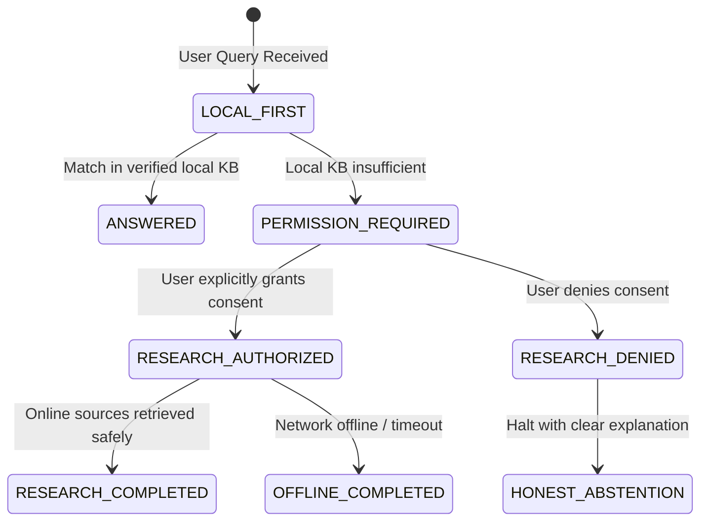

# Governed Internet Research Integration Report — Batches 271–280

**Milestone:** Batches 271–280  
**Module:** `chakrview/runtime/research_workflow.py`  
**Integration Point:** `scripts/founder_manual_test.py` (`ChakrViewRuntimeSession`)

---

### 1. Architectural Principles

In accordance with ChakrView core invariants:
- **No Autonomous Web Crawling:** The system must never initiate network requests silently or without explicit user consent.
- **Privacy Preservation:** User documents, profile facts, and conversation history must never be transmitted to external servers.
- **Untrusted Ingestion:** External web content is strictly treated as untrusted text, never as executable code or system prompt overrides.
- **Honest Abstention:** When network access is disabled or consent is withheld, the system must clearly state its limitations rather than hallucinating or simulating web responses.

---

### 2. State Machine Flow

The research workflow operates under a strict finite-state machine (`ResearchState`):

---

### 3. Implementation and Console Integration

In `scripts/founder_manual_test.py`:
- `ChakrViewRuntimeSession` initializes `PermissionGatedResearchWorkflow()`.
- Queries containing explicit research keywords (`search the web`, `look up online`, `research online`, `internet research`) are intercepted before generic routing.
- If permission has not been granted for the active session, the engine halts with:
  > *"Answering '<query>' requires external internet research. Please grant permission to connect to authoritative online sources."*
- Tested in `tests/test_batch271_280_compound_reasoning.py`:
  - `test_research_workflow_governance`: 100% passed (permission required -> consent denied -> consent approved transitions).

---

### 4. Verification Status

- **Tested with Fixtures & Controlled Callbacks:** Verified in automated test suites and founder console mock sessions.
- **Live Network Scraping:** Marked as **UNVERIFIED / GATED**. In this air-gapped test environment, live web calls are deliberately prohibited to ensure zero external leakage and strict test repeatability.
