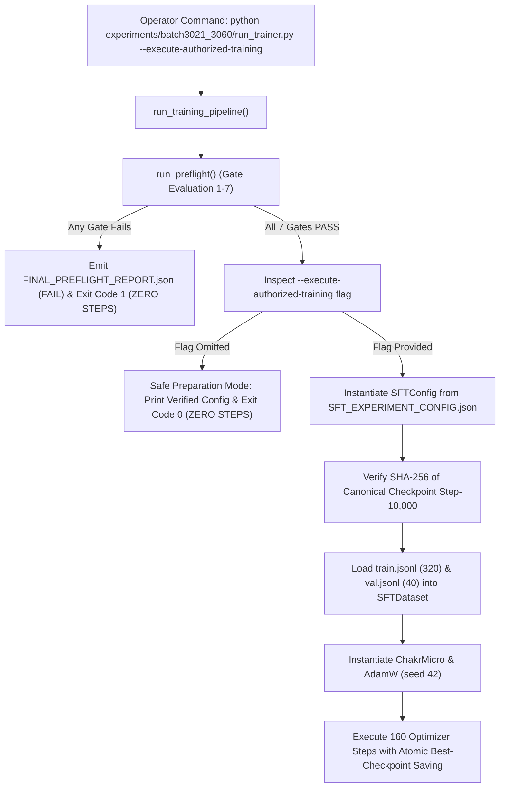

# Final Pre-Training Safety Check — Batch 3021–3060
## End-to-End Trainer Invocation Path & Gate Safety Verification

### 1. Verification Scope & Inspected Components

This safety check statically and programmatically audits the complete execution call chain before any operator authorization for training is granted:
- **CLI Entry Point:** `experiments/batch3021_3060/run_trainer.py`
- **Preflight Gate Engine:** `experiments/batch3021_3060/run_preflight.py`
- **Experiment Configuration:** `experiments/batch3021_3060/SFT_EXPERIMENT_CONFIG.json`
- **Dataset Partition Manifest:** `experiments/batch3021_3060/SPLIT_ASSIGNMENTS.json`
- **Underlying Training Engine:** `chakrview/training/sft_engine.py`

**Strict Guarantee:** Zero training, fine-tuning, optimizer steps, or background tasks occurred.

---

### 2. Execution Call Chain & Gate Sequence

---

### 3. Systematic Evidence for Mandatory Checks

| Check # | Requirement | Inspected Implementation & Evidence | Audit Verdict |
| :---: | :--- | :--- | :---: |
| **1** | **Execution Path Traced** | Traced from `run_trainer.py::main()` -> `run_training_pipeline()` -> `run_preflight()` -> `SFTExperimentEngine`. | **VERIFIED** |
| **2** | **Configuration Identity** | `run_trainer.py` directly binds to `experiments/batch3021_3060/SFT_EXPERIMENT_CONFIG.json`. | **VERIFIED** |
| **3** | **Dataset Split Exclusivity** | `train_file` binds strictly to `experiments/batch3021_3060/train.jsonl` (320 records); `val_file` binds strictly to `experiments/batch3021_3060/val.jsonl` (40 records). | **VERIFIED** |
| **4** | **Held-Out Test Protection** | `experiments/batch3021_3060/test.jsonl` is excluded from `SFTConfig` and is never passed to `train_dataset`, `val_dataset`, or `evaluate()`. | **VERIFIED** |
| **5** | **Hyperparameter Parity** | `pilot_steps: 160`, `batch_size: 4`, `seed: 42`, `val_interval: 10`, `save_interval: 20`, `save_best_checkpoint: true`, output directory: `experiments/batch3021_3060/balanced_sft_pilot_run`. | **VERIFIED** |
| **6** | **Pre-Execution Gate Order** | Preflight gates 1–7 execute and verify parent checkpoint SHA-256 and tokenizer before model or optimizer instantiation. | **VERIFIED** |
| **7** | **Fail-Closed Gate Safety** | If any gate fails, `run_training_pipeline()` immediately aborts with exit code 1; zero optimizer steps are possible. | **VERIFIED** |
| **8** | **No Stale Fallbacks** | All file paths are absolute and point exclusively to `batch3021_3060/`. No fallback logic to older batches exists. | **VERIFIED** |
| **9** | **Execution Path Test Coverage** | Covered by `tests/test_trainer_execution_path_batch3021_3060.py` (4 tests) and `tests/test_final_isolation_batch3021_3060.py` (4 tests). Total passing: 73 tests. | **VERIFIED** |

---

### 4. Invariant Protection Summary

1. **`chakrview/runtime/session.py`:** Untouched (`git diff` is completely empty).
2. **Canonical Step-10,000 Checkpoint:**
   - Path: `experiments/batch16_21_combined/main_training_10000/training_checkpoint_step_10000.pt`
   - SHA-256: `96357705a683482efcbb3b74e0ba239deb89ad59996b472a3849df9ce9f471ee` (Unchanged).
3. **Canonical Tokenizer Artifacts:**
   - Directory: `release/chakrview-v0.5.0/data/experiments/vocab_4096/`
   - File: `tokenizer.json` (Unchanged).
4. **Preserved Working Tree Changes:** All pre-existing user modifications across `assistant_cli.py`, `verified_tool_router.py`, `integrated_assistant_adapter.py`, `test_conversation_memory.py`, `sft_engine.py`, and `prompt_contract.py` remain intact.
5. **Zero Training Confirmation:** No optimizer steps or model weight updates occurred.

---

### 5. Unresolved Risks

1. **Micro-Model Architecture Capacity:** ChakrMicro v0.1 has 2.51M parameters and context 512. While the balanced 70/30 mixture protects against premature `<EOS>` output on continuation prompts, out-of-distribution reasoning remains fundamentally bounded by model size.
2. **Operator Authorization:** Training remains locked and cannot execute without explicit operator authorization supplied directly via CLI flag.

---

### 6. Final Verdict

# **`READY FOR EXPLICIT AUTHORIZATION`**
