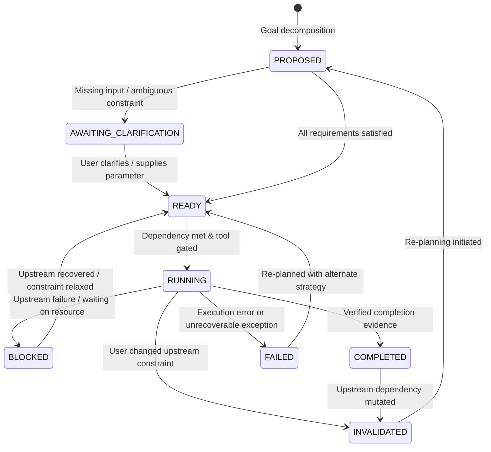

# Task Plan Contract: Batches 661–700
## Hierarchical Dialogue Planning, Episodic Memory & Evidence-Grounded Multi-Step Reasoning

**Version:** 1.0.0  
**Status:** FROZEN  
**Contract Date:** 2026-10-15  
**Governing Module:** `chakrview/runtime/hierarchical_planner.py`  

---

### 1. Architectural Purpose

ChakrView's Hierarchical Dialogue Planner coordinates complex, multi-turn, multi-step user goals. It avoids superficial sequential text execution by structuring work into explicit, typed Directed Acyclic Graphs (DAGs) of subtasks, tracking intermediate artifacts, recording evidence provenance, and supporting interactive replanning when user constraints change or information is missing.

---

### 2. Task State Lifecycle

A Task Plan and each constituent Subtask follow a deterministic, auditable state machine:



#### Task States Defined:
1. `PROPOSED`: Subtask generated by planner; inputs and dependencies not yet verified.
2. `AWAITING_CLARIFICATION`: Required parameter or reference is missing/ambiguous. Planner must generate targeted user inquiry before proceeding.
3. `READY`: All upstream dependencies completed and validated; required tools have execution permission.
4. `RUNNING`: Currently being evaluated by tool executor or neural reasoning core.
5. `BLOCKED`: Upstream subtask failed or external dependency unresolved.
6. `COMPLETED`: Verified execution result or grounded text produced; intermediate artifact persisted.
7. `FAILED`: Tool failure or constraint violation.
8. `CANCELLED`: Explicitly cancelled by user direction or workflow diversion.
9. `INVALIDATED`: A completed or ready task rendered invalid because a user updated a prior constraint.

---

### 3. Data Representation Schemas

#### 3.1 Subtask Object Schema
```python
@dataclass
class Subtask:
    subtask_id: str                          # e.g., "st_01"
    goal_description: str                    # Human-readable objective
    action_type: str                         # "tool_call" | "text_transform" | "clarification" | "reasoning"
    tool_name: Optional[str] = None          # e.g., "calculator", "text_utility", "retriever"
    tool_arguments: Dict[str, Any] = field(default_factory=dict)
    dependencies: List[str] = field(default_factory=list) # IDs of required prerequisite subtasks
    status: SubtaskStatus = SubtaskStatus.PROPOSED
    input_bindings: Dict[str, str] = field(default_factory=dict) # Argument name -> Upstream subtask ID or memory key
    result_artifact: Optional[Any] = None    # Stored output produced upon completion
    evidence_provenance: Optional[str] = None # Provenance of evidence used
    error_message: Optional[str] = None
    created_at: float = field(default_factory=time.time)
    completed_at: Optional[float] = None
```

#### 3.2 Hierarchical Task Plan Schema
```python
@dataclass
class TaskPlan:
    plan_id: str
    session_id: str
    user_goal: str
    subtasks: List[Subtask]
    active_constraints: Dict[str, Any]       # e.g., {"language": "English", "max_length": 50}
    plan_status: TaskPlanStatus = TaskPlanStatus.PROPOSED
    version: int = 1                         # Incremented on replanning
    superseded_by: Optional[str] = None      # ID of newer plan version if replanned
    created_at: float = field(default_factory=time.time)
    updated_at: float = field(default_factory=time.time)
```

---

### 4. Dependency & Execution Rules

1. **DAG Invariant:** Subtask dependencies must form a strictly acyclic graph. Self-dependencies and circular dependencies are rejected immediately.
2. **Dynamic Binding:** A subtask may bind its arguments to the output of an upstream subtask (e.g., `input_bindings={"expression_base": "st_01.result"}`). The executor resolves these bindings only after the upstream subtask transitions to `COMPLETED`.
3. **Constraint Invalidation Cascade:** If the user alters a constraint (e.g., *"Actually change the multiplier to 7"*), all subtasks that directly or indirectly depended on the altered parameter transition to `INVALIDATED`. Unrelated subtasks retain their `COMPLETED` status.
4. **Tool Gating & Permission Boundary:** Tools with side effects or non-trivial resources require explicit verification. Ambiguous plans cannot trigger tool execution.
5. **Session Isolation:** No subtask may bind to or reference state, artifacts, or plans from a different `session_id`.
