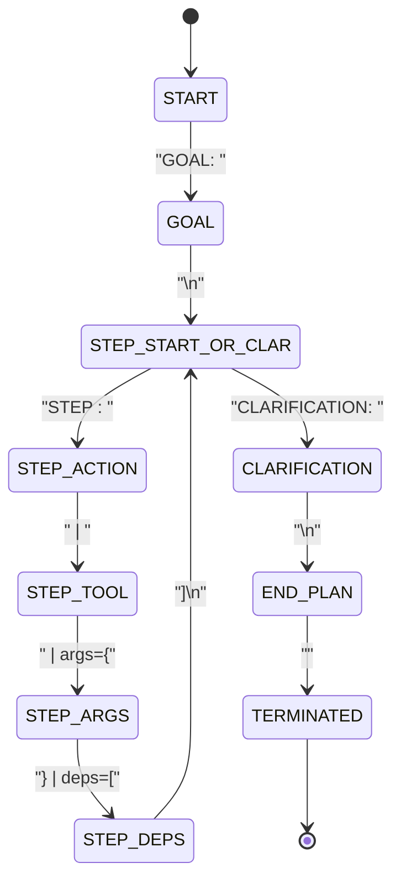

# Grammar Decoder Design Specification: Batches 781–820
## Incremental State Machine, Multi-Character Tokenizer Mapping & Logit Masking

**Date:** 2026-10-15  
**Milestone:** Batches 781–820  
**Repository:** `ChakrView`  
**Location:** `experiments/batch781_820/reports/GRAMMAR_DECODER_DESIGN.md`

---

### 1. Architectural Motivation

In Batch 741–780, unconstrained autoregressive plan generation achieved only 26.7% accuracy on held-out tasks. The root cause was token-level punctuation and delimiter drift: greedy decoding frequently produced syntax fragments like `args={text='Ne}` or omitted closing braces and terminal `<END_PLAN>` markers, triggering rejection by `PlanDSLValidator`.

To eliminate token drift without substituting gold answers or bypassing neural generation, we designed and implemented `GrammarConstrainedDecoder` (`chakrview/cognition/grammar_constrained_decoder.py`).

---

### 2. Incremental Grammar State Machine

The decoder models Plan DSL as an incremental pushdown/finite state automaton:

#### Supported Grammar Productions
1. **Goal Line:** `GOAL: <goal_id>` where `goal_id` $\in$ `ALLOWED_GOALS`.
2. **Step Line:** `STEP <id>: <action> | <tool> | args={<args>} | deps=[<deps>]`.
3. **Clarification Line:** `CLARIFICATION: NEEDED` or `CLARIFICATION: NONE`.
4. **End Plan Marker:** `<END_PLAN>`.

---

### 3. Tokenizer Multi-Character Handling & Vocabulary Awareness

Because BPE tokens can represent multiple characters (e.g. token 726 = `'arg'`, token 127 = `'|'`, token 35 = `' '`), the decoder precomputes a lookup table of decoded string representations for all 4,096 tokens in the vocabulary.

At each step of autoregressive generation:
1. `current_text` is the string generated so far.
2. For each candidate token $t \in \mathcal{V}$:
   - Form candidate sequence $s = \text{current\_text} + \text{decode}(t)$.
   - Pass $s$ through `PlanDSLGrammarChecker.is_valid_partial(s)`.
   - If valid, $t$ is added to `allowed_tokens`.
3. If no legal token exists, the decoder **fails closed** with a recorded decoding error rather than silently disabling constraints.
4. Non-allowed logits are masked with $-\infty$:
   $$\text{logits}[t] = \begin{cases} \text{logits}[t] & \text{if } t \in \text{allowed\_tokens} \\ -\infty & \text{otherwise} \end{cases}$$
5. The neural model's highest-probability legal continuation is selected.

---

### 4. Safety & Provenance Integrity
- **No Gold Injection:** The grammar constraint only restricts token generation to syntactically valid EBNF productions. It does not guide tool choice, operand values, or graph topology.
- **Fail-Closed Execution:** If generation exhausts `max_new_tokens` without reaching `<END_PLAN>`, the plan is marked invalid and blocked from tool execution.
