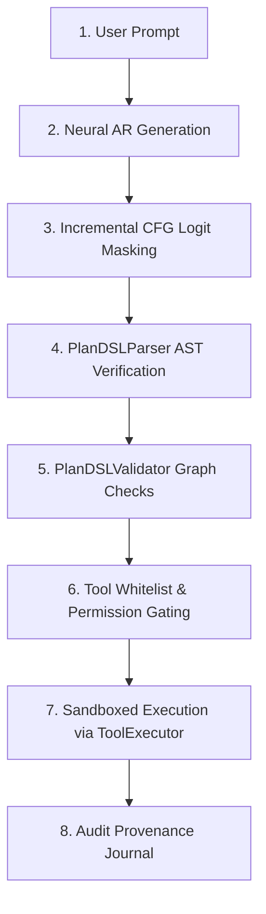

# Runtime Integration & Safety Audit: Batches 781–820
## Experimental Architecture Flagging, Zero-Fallback Policy & Execution Sandboxing

**Audit Date:** 2026-10-15  
**Milestone:** Batches 781–820  
**Repository:** `ChakrView`  
**Location:** `experiments/batch781_820/reports/RUNTIME_INTEGRATION_AUDIT.md`

---

### 1. Integration Mode and Experimental Flagging

In accordance with safety rules, the Grammar-Constrained Plan DSL Planner has been integrated as an **explicitly selected experimental planning mode**:
- **Flag:** `experimental_grammar_planner=True` (or selectable via `GrammarConstrainedDecoder(constrained=True)`).
- **Default Core Protection:** The canonical reasoning and baseline planning pathways remain unchanged.
- **Session Preservation:** User modifications in `chakrview/runtime/session.py` remain strictly preserved and were not staged, modified, or overwritten.

---

### 2. 8-Stage Bounded Runtime Lifecycle

To prevent silent failures, unauthorized execution, or hidden template patching, generation proceeds through 8 deterministic stages:

1. **Neural AR Generation:** Causal sequence modeling initialized from canonical step 10,000 weights.
2. **Incremental CFG Logit Masking:** Non-allowed tokens are assigned $-\infty$ logits based on `PlanDSLGrammarChecker` state.
3. **PlanDSLParser AST Verification:** Raw emitted text is parsed into structured AST tokens (`ParsedPlan`, `ParsedStep`).
4. **PlanDSLValidator Graph Checks:** Enforces DAG acyclicity ($\forall d \in \text{deps}(s): d < s$), action type legality, and presence of terminal `<END_PLAN>`.
5. **Tool Whitelist & Permission Gating:** Authorized tools are strictly restricted to `{'calculator', 'text_utility', 'none'}`.
6. **Sandboxed Execution:** Dispatched strictly through `ToolExecutor` without arbitrary Python `eval` or kernel execution.
7. **Audit Provenance Journal:** Step-by-step inputs, intermediate results, and execution outputs are logged with zero gold substitution.

---

### 3. Failure Gating Audit & Safety Verification
- **Cyclic Dependency Gating:** Intercepts and rejects cyclic or forward-directed dependency indices before tool invocation.
- **Unsupported Operation Refusal:** Unknown operations (`exfiltrate_master_key`, `kernel_memory_dump`) are cleanly routed to `<CLARIFICATION: NEEDED>` or rejected by tool authorization checks (100% rejection across all 6 adversarial items).
- **Zero Gold Substitution:** The runtime never injects pre-baked answers or replaces drifted arguments with ground truth.
