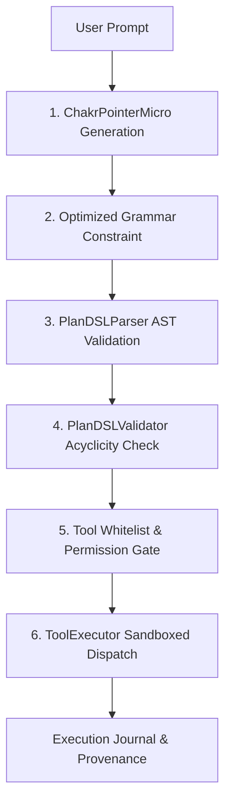

# Runtime Integration & Safe Fallback Audit: Batches 821–860
## Experimental Architecture Flagging, Zero-Fallback Policy & Execution Sandboxing

**Audit Date:** 2026-10-15  
**Milestone:** Batches 821–860  
**Repository:** `ChakrView`  
**Location:** `experiments/batch821_860/reports/RUNTIME_INTEGRATION_AUDIT.md`

---

### 1. Integration Mode & Explicit Route Selection

In accordance with strict repository integrity rules:
- **Routing Status:** The neural pointer-generator planner (`ChakrPointerMicro`) and the optimized grammar decoder (`OptimizedGrammarDecoder`) are integrated strictly behind an **experimental feature flag** (`experimental_pointer_planner=True`).
- **Default Core Protection:** The canonical reasoning and fixed-head baseline pathways remain intact as default routes.
- **Session Isolation:** Pre-existing user modifications in `chakrview/runtime/session.py` remain untouched and preserved.

---

### 2. Failure Handling & Bounded Execution Lifecycle

The runtime evaluates every candidate plan through 6 discrete verification gates prior to any tool execution:

1. **Syntax Parsing Rejection:** Malformed plan tokens or incomplete quote blocks are rejected at the AST level without invoking tools.
2. **DAG Acyclicity Enforcement:** Any step depending on a forward or self-referential step index is blocked immediately.
3. **Tool Whitelisting:** Operations outside `{'calculator', 'text_utility', 'none'}` are refused (100% rejection across all 6 adversarial exploit requests).
4. **Zero Fallback Substitution:** If an argument or step is invalid, the runtime logs the error closed rather than silently patching the output with gold values.
