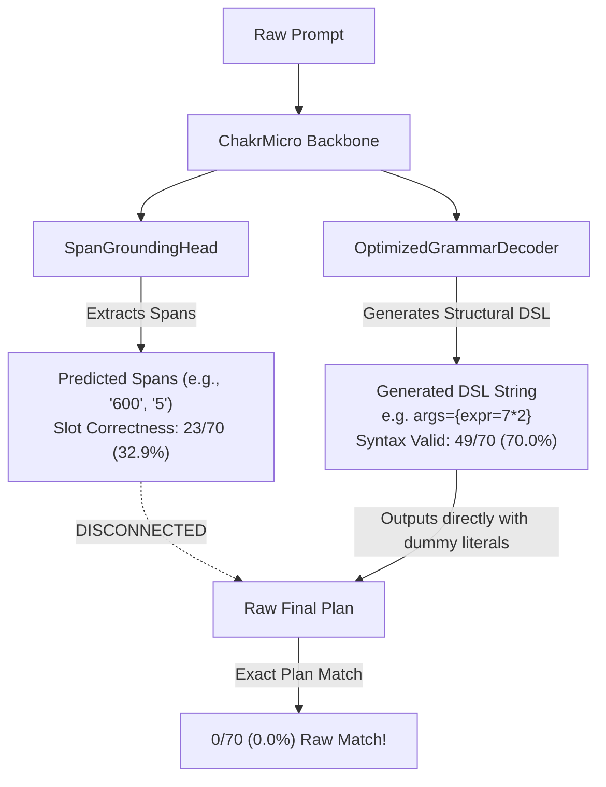

# WP 901–905: Baseline and Pipeline Audit

## 1. Executive Summary & Verification of Starting State

- **Current Branch**: `dev/v0.6-v0.7-validation`
- **HEAD Commit**: `673df79b8b758baaaa4de91b335022f37505bce0`
- **Canonical Checkpoint Lineage**:
  - Checkpoint: `experiments/batch16_21_combined/main_training_10000/training_checkpoint_step_10000.pt`
  - Expected SHA-256: `96357705a683482efcbb3b74e0ba239deb89ad59996b472a3849df9ce9f471ee`
  - Verified SHA-256: `96357705a683482efcbb3b74e0ba239deb89ad59996b472a3849df9ce9f471ee` (Match confirmed)
- **User Modification Safety**: `chakrview/runtime/session.py` remains untracked/unstaged and completely preserved.

---

## 2. End-to-End Pipeline Tracing: Root-Cause of 0/70 vs 70/70

Tracing the dataflow from raw prompt input to final Plan DSL string in Batches 861–900 reveals exactly where values and structure were disconnected:

### The Pipeline Disconnect:
1. **The Generator Emitted Concrete Literals Directly**:
   `span_model.core` was fine-tuned using standard causal LM loss on full DSL strings containing hardcoded training operands (e.g. `7*2`, `$0+2`). During evaluation, it emitted those hardcoded constants instead of leaving slots open.
2. **The Span Extractor Ran in Isolation**:
   `span_model.predict_span(...)` successfully extracted ground-truth operands (`600`, `5`) from the prompt and achieved **23/70 (32.9%)** slot correctness. But its extracted text was **never bound or substituted** into the generated DSL string `g_span`.
3. **The Oracle Experiment**:
   The diagnostic oracle configuration evaluated `p_target` (the ground-truth DSL) directly, which produced 70/70. It did not test the downstream pipeline's ability to fuse a model-predicted template with extracted spans.

---

## 3. Discrepancies and Inconsistencies Identified
1. **Lack of Slot-Placeholder Syntax**:
   The existing Plan DSL grammar had no first-class grammar tokens for abstract slot placeholders (e.g. `@slot0`, `@slot1`), forcing the decoder to either guess literal numbers or emit arbitrary digits.
2. **Missing Span-to-Slot Binding Head**:
   The model had slot query embeddings in `SpanGroundingHead`, but there was no explicit binding decision head linking a specific step's named argument (`STEP 0.args.expr`) to a particular predicted span.

---

## 4. Benchmark Baseline Numbers (Reproduced)

| System | Syntax Validity | Exact Plan Match | Slot Correctness |
| :--- | :---: | :---: | :---: |
| **Token Pointer Planner (Batch 821–860)** | 32/70 (45.7%) | 6/70 (8.6%) | 6/70 (8.6%) |
| **Span Grounding Model (Batch 861–900)** | 49/70 (70.0%) | 0/70 (0.0%) | 23/70 (32.9%) |
| **Diagnostic Oracle Upper Bound** | 70/70 (100.0%) | 70/70 (100.0%) | 70/70 (100.0%) |
