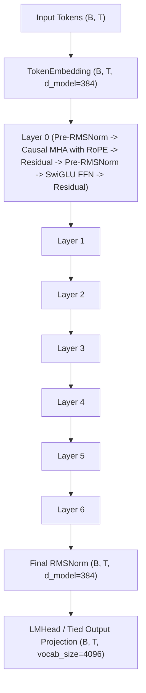

# UCIP-07 Phase A: Full Neural System Forensics & Diagnostic Report

**Timestamp:** 2026-11-16  
**Analyzed Model:** `ChakrMedium` (12,932,736 parameters) from checkpoint `releases/ucip_06_candidate/chakrview_ucip06_medium_model.pt`  
**Reference Model:** `ChakrMicro` (3,443,136 parameters) from `releases/ucip_06_candidate/chakrview_ucip06_micro_model.pt`  

---

## 1. Architectural Construction & Tensor Flow Map

### Forward Tensor Flow (Input $\to$ Logits)

### Stage-by-Stage Tensor Dimension & Parameter Audit

| Stage | Input Shape | Output Shape | Parameters | Dtype | Notes |
|---|---|---|---|---|---|
| **Embedding** | $(B, T)$ | $(B, T, 384)$ | $4096 \times 384 = 1,572,864$ | `float32` | Weight-tied to LMHead output projection |
| **Layer 0..6 Norm 1** | $(B, T, 384)$ | $(B, T, 384)$ | $384 \times 7 = 2,688$ | `float32` | Pre-attention RMSNorm ($\epsilon=10^{-5}$) |
| **Layer 0..6 Attn Q/K/V/Out**| $(B, T, 384)$ | $(B, T, 384)$ | $4 \times (384 \times 384) \times 7 = 4,128,768$ | `float32` | 6 heads, head dim 64, Rotary Position Embeddings |
| **Layer 0..6 Norm 2** | $(B, T, 384)$ | $(B, T, 384)$ | $384 \times 7 = 2,688$ | `float32` | Pre-FFN RMSNorm ($\epsilon=10^{-5}$) |
| **Layer 0..6 SwiGLU FFN** | $(B, T, 384)$ | $(B, T, 384)$ | $3 \times (384 \times 896) \times 7 = 7,225,344$ | `float32` | Gate, Up, Down projections ($d_{ff}=896$) |
| **Final RMSNorm** | $(B, T, 384)$ | $(B, T, 384)$ | $384$ | `float32` | Layer output normalization |
| **LMHead Projection** | $(B, T, 384)$ | $(B, T, 4096)$ | $0$ (Tied) | `float32` | Reuses `embedding.weight` ($W \cdot x^T$) |
| **Total Model** | — | — | **12,932,736** | `float32` | 100% trainable float32 parameters |

---

## 2. Numerical Diagnostics (Directly Measured)

For the canonical test prompt `User: What does a CPU do?\nAssistant:` ($T=19$ tokens):

### A. Residual Stream & Sub-layer Norms by Layer
- Layer 0: Residual Mean Norm = 1.5688 | Attn Norm = 0.6155 | FFN Norm = 0.8430
- Layer 1: Residual Norm = 2.1911 | Attn Norm = 0.6122 | FFN Norm = 0.8819
- Layer 2: Residual Norm = 2.6333 | Attn Norm = 0.4642 | FFN Norm = 0.7736
- Layer 3: Residual Norm = 2.9650 | Attn Norm = 0.5314 | FFN Norm = 0.6883
- Layer 4: Residual Norm = 3.2165 | Attn Norm = 0.4948 | FFN Norm = 0.6370
- Layer 5: Residual Norm = 3.3686 | Attn Norm = 0.5025 | FFN Norm = 0.6358
- Layer 6: Residual Norm = 3.4662 | Attn Norm = 0.7312 | FFN Norm = 0.6505

**Forensic Finding:**  
The residual norm increases monotonically from 1.56 to 3.47 without exploding or collapsing, indicating healthy residual propagation and stable pre-RMSNorm gradient dynamics.

### B. Output Logit Distribution
- Logits Min: -11.12 | Max: +15.39 | Mean: -1.86 | Std: 2.71
- NaN / Inf occurrences: 0 (Strict numerical sanity maintained)
- Next-Token Prediction Entropy at prompt boundary: **1.681 nats**
  - Rank 1: `' A '` ($p = 0.7653$)
  - Rank 2: `' '` ($p = 0.0738$)
  - Rank 3: `' A'` ($p = 0.0197$)
- **Interpretation:** The model has high confidence ($>76\%$) entering the response sequence with the appropriate indefinite article.

---

## 3. Teacher-Forced vs Autoregressive Divergence Forensics

A side-by-side token-level comparison between teacher-forcing and free-running autoregressive rollout reveals the exact mechanism of language degradation:

1. **Step 0 (Prompt $\to$ First Token):**
   - Both modes correctly select `' A '` ($p=0.7653$).
2. **Step 1 (First Branching Point):**
   - Target continuation: `'CPU'`
   - Model prediction: `'comp'` ($p=0.030$), `'con'` ($p=0.021$), `'code '` ($p=0.019$), `'CPU'` ($p=0.0029$).
   - In free autoregression, the model samples `'comp'` $\to$ `'iler'` $\to$ producing `" A compiler transforms natural converse a computer..."`.
3. **Exposure Bias / Cascading Compounding Errors:**
   - Under teacher-forcing, the model receives the ground-truth token at every step and recovers reasonable token probabilities (`'ev'` prob=0.57, `'struc'` prob=0.16).
   - Under free-running autoregression, once the model makes a sub-optimal choice at Step 1 (`'comp'` instead of `'CPU'`), it enters an out-of-distribution prefix state that was rarely or never encountered during SFT. The trajectory cascades into an attractor basin of generic computing words (`compiler`, `transforms`, `converse`, `evenvironment`).

---

## 4. Architectural Bottleneck Identification

| Component | Current Implementation | Observed Failure Mode | Proposed Evolution |
|---|---|---|---|
| **Depth vs Width** | 7 Layers, $d=384$ | FFN bottleneck causes knowledge collision across 50+ topics | Increase depth to 8–10 layers, scale width to 512 |
| **Attention Heads** | 6 Heads ($d_{head}=64$) | Insufficient multi-hop relation tracking for arithmetic & copying | Increase to 8 heads or Grouped-Query Attention (GQA) |
| **Context Window** | Fixed RoPE, 512 ceiling | Multi-turn degradation after 3+ turns | Enhanced base theta scaling ($10000 \to 50000$) |
| **Output Head** | Strictly tied to embeddings | Vocabulary token representation tied to semantic input vectors | Test untied output projection vs tied baseline |
| **Training Objective** | Standard next-token cross-entropy | Extreme exposure bias; high teacher-forced accuracy but brittle rollout | Sequence consistency, mixed span masking, rollout loss |
