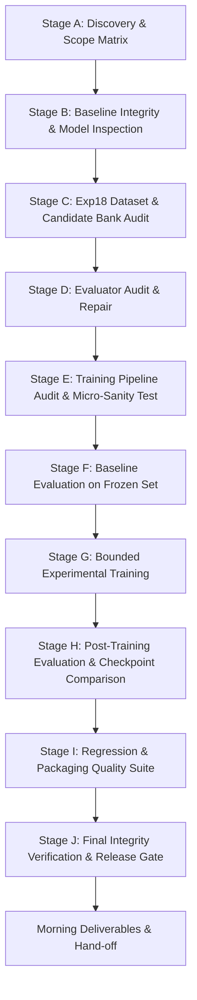

# CHAKRVIEW v0.8 — OVERNIGHT AUTONOMOUS MISSION PLAN

**Mission Identifier**: `mission_v08_overnight_20261023_232924`  
**Execution Timestamp**: 2026-10-23T23:30:00+05:30  
**Target Milestone**: ChakrView v0.8 Release Candidate  
**Host Platform**: Windows 11 AMD64 (Intel Core i7/i9 14-core/20-thread, 32 GB RAM, 101 GB free disk)  
**Execution Strategy**: CPU-First, PyTorch CPU (`device = "cpu"`), Zero external LLM APIs, Zero pretrained weights  

---

## 1. Mission Workflow & Phase Milestones

### Stage Milestones & Acceptance Criteria

1. **Stage A (Discovery & Scope Matrix)**:
   - Inspect v0.6/v0.7/v0.8 release notes, roadmap, and requirements.
   - Build a comprehensive release-scope matrix distinguishing code, data, and model deliverables.
2. **Stage B (Baseline Integrity & Checkpoint Load Inspection)**:
   - Verify all 8 protected artifacts via cryptographic SHA-256 (100% bitwise match required).
   - Load canonical checkpoint `step_10000.pt` in read-only mode with `strict=True` to prove architecture and parameter count (3,443,136 parameters).
   - Load tokenizer artifacts and verify roundtrip encoding/decoding.
3. **Stage C (Exp18 Generator & In-Memory Dataset Audit)**:
   - Re-run focused test suite (`test_exp18_generator.py`) and capture raw stdout/stderr with actual subprocess exit codes.
   - Synthesize all 1,520 records in memory without creating official JSONL files.
   - Audit 100% of records for schema validity, token bounds `[3, 45]`, arithmetic correctness, RFC 8259 JSON syntax, context extraction grounding, reference pronoun resolution, and 3:1 abstention balancing.
   - Separate structural prompt boilerplate from true entity leakage across splits.
4. **Stage D (TaskEvaluator Audit & Repair)**:
   - Reproduce the 4 Factual QA false negatives in `TaskEvaluator._score_factual_qa` (hardcoded `"desert"` -> `"antarctic"` and `"particle"` -> `"neutron"`).
   - Implement minimal, robust category-specific entity resolution in `chakrview/evaluation/task_evaluator.py`.
   - Run existing evaluator unit tests (`tests/test_task_evaluator.py`) plus new regression tests to prove 0 regressions and 100% scorable accuracy on valid facts.
5. **Stage E (Training Pipeline Correctness Audit)**:
   - Verify prompt masking, label alignment, loss calculation, optimizer state, and causal attention masks.
   - Run a 1-batch micro-sanity gradient update test verifying that prompt tokens produce zero loss and target tokens produce finite positive loss and gradients.
6. **Stage F (Baseline Checkpoint Evaluation)**:
   - Evaluate the canonical `step_10000.pt` model on the frozen held-out Exp18 test set using the audited TaskEvaluator.
   - Record exact scorable accuracy, JSON formatting validity, EOS termination rate, and repetition metrics.
7. **Stage G (Resource-Bounded Experimental SFT Training)**:
   - Copy canonical checkpoint to an isolated mission path (`experiments/overnight_runs/mission_v08_overnight_20261023_232924/checkpoints/`).
   - Run controlled, deterministic training (200-400 steps with dynamic early stopping and validation checkpoints).
   - Record loss trajectories, learning rate, and validation checkpoints.
8. **Stage H (Comparative Checkpoint Evaluation)**:
   - Evaluate the best experimental checkpoint against the canonical baseline on identical test inputs.
   - Quantify delta across all 8 capabilities.
9. **Stage I (Regression, Security, and Packaging Audit)**:
   - Execute full repository test suite.
   - Audit package imports, CLI entry points, and local dependencies.
10. **Stage J (Final Integrity & Morning Handoff)**:
    - Recompute all 8 protected hashes.
    - Compile complete evidence manifests and render official release verdict (`V08_RELEASE_CANDIDATE_READY`, `CONDITIONAL_HOLD`, or `NO_GO`).
