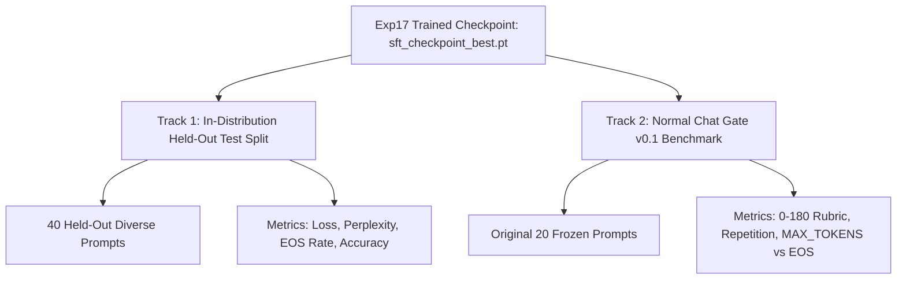

# ChakrView Exp17 Instruction SFT v1 — Evaluation Protocol Specification

**Experiment ID**: `exp17_instruction_sft_v1`  
**Parent Directory**: `experiments/research_v09_conversation_sft/exp17_instruction_sft_v1/`  
**Status**: EVALUATION PROTOCOL SPECIFICATION ONLY

---

## 1. Dual Evaluation Architecture

To ensure both task-specific fine-tuning validation and non-regression against foundational capabilities, Exp17 establishes a **Dual Evaluation Framework**:

---

## 2. Track 1: In-Distribution Held-Out Evaluation (`test_exp17_v1.jsonl`)

Evaluates performance on 40 held-out conversational examples spanning all 8 categories.

### 2.1 Quantitative Metrics
1. **Validation Loss & Perplexity**:
   - Evaluated across all 40 held-out examples with prompt-masked loss.
   - Target: $\mathcal{L}_{\text{test}} \le 2.50$, $\text{Perplexity} \le 12.0$.
2. **Clean Turn Termination Rate ($\text{EOS}\%$ Rate)**:
   - Evaluated under greedy decoding (`temp=0.0`, `max_new_tokens=48`, `stop_on_eos=True`).
   - Formula:
     $$\text{EOS Rate} = \frac{N(\text{stop\_reason} == \text{"STOP\_TOKEN"})}{N_{\text{total}}} \times 100\%$$
   - Success Threshold: $\ge 75.0\%$ (vs. 0.0% in Gate v0.1 baseline).
3. **Exact & Extractive Accuracy**:
   - *Factual & Arithmetic*: Exact or normalized match against ground truth response.
   - *Extractive Context QA*: Presence of ground truth entity in decoded output.
   - *Abstention Accuracy*: Proper expression of uncertainty on unanswerable prompts.

---

## 3. Track 2: Normal Chat Gate v0.1 Benchmark Replication

Evaluates the fine-tuned checkpoint against the frozen 20-prompt suite in `experiments/normal_chat_gate_v01/prompts.jsonl`.

### 3.1 Inference Configuration
To isolate the impact of SFT, inference uses the identical execution harness and parameters as Gate v0.1:
- Harness: `chakrview.runtime.neural_runtime_adapter.NeuralRuntimeAdapter`
- Prompt Mode: `plain_instruction` (default) and `context_qa` (when context is provided)
- Decoding Mode: `greedy` (`temperature = 0.0`)
- Max New Tokens: `48`
- Repetition Penalty: `1.0` (unpenalized raw baseline)
- Stop Tokens: `[EOS_ID]` (token `1`)
- Stop on EOS: `True` (`active_eos_stop = True`)

### 3.2 Scoring Rubric & Comparison Baseline
Scored against the reconciled 0–2 rubric ([FINAL_AUDIT_RECONCILIATION.md](file:///D:/Project/ChakrView/experiments/normal_chat_gate_v01/FINAL_AUDIT_RECONCILIATION.md)):

| Evaluation Dimension | Possible Points | Step 10,000 Base Score | Exp17 Target Score | Success Criterion |
| :--- | :---: | :---: | :---: | :--- |
| **Relevance** | 40 | 0 (0.0%) | $\ge 24$ (60.0%) | Model responds to query intent. |
| **Instruction Following** | 40 | 0 (0.0%) | $\ge 20$ (50.0%) | Adheres to constraints and formatting. |
| **Grounding in Context** | 12 | 0 (0.0%) | $\ge 6$ (50.0%) | Extracts facts from provided context (6 prompts). |
| **Task Completion / Reasoning** | 40 | 0 (0.0%) | $\ge 20$ (50.0%) | Fulfills conversational tasks. |
| **Appropriate Uncertainty** | 8 | 0 (0.0%) | $\ge 4$ (50.0%) | Abstains on unanswerable queries (4 prompts). |
| **Repetition / Termination** | 40 | 0 (0.0%) | $\ge 28$ (70.0%) | Emits EOS cleanly without loops. |
| **TOTAL BENCHMARK SCORE** | **180** | **0 / 180 (0.0%)** | **$\ge 90$ / 180 (50.0%)** | **Significant non-zero capability gain.** |

---

## 4. Repetition & Degeneracy Diagnostics

Recomputed using the exact audited heuristics from Gate v0.1:

1. **Word-Level Trigram Duplication**:
   - Formula: $(N_{\text{trigrams}} - N_{\text{unique}}) \ge 1$ across lowercase words.
   - Baseline: 15 / 20 prompts (75.0%).
   - Target: $\le 4$ / 20 prompts ($\le 20.0\%$).
2. **Token-Level Bigram Looping**:
   - Formula: $\ge 4$ occurrences of identical token pair `(t_i, t_{i+1})`.
   - Baseline: 19 / 20 prompts (95.0%).
   - Target: $\le 2$ / 20 prompts ($\le 10.0\%$).
3. **Consecutive Newline / Character Runaway**:
   - Formula: $\ge 10$ consecutive identical characters or newlines.
   - Baseline: 2 / 20 prompts (10.0%).
   - Target: **0 / 20 prompts (0.0%)**.
4. **Pretraining Arithmetic Header Bias**:
   - Formula: Presence of `Step-by-Step Solution:` on non-arithmetic prompts.
   - Baseline: 6 / 20 prompts (30.0%).
   - Target: **0 / 20 prompts (0.0%)**.

---

## 5. Exploratory Sampling Protocol (Phase 2 Diagnostics)

Following the primary greedy evaluation, an exploratory diagnostic run will evaluate decoding under nonzero temperature and repetition penalty:
- `temperature`: `0.7`
- `top_k`: `40`
- `top_p`: `0.9`
- `repetition_penalty`: `1.15`

This will empirically test the hypothesis that repetition penalties complement instruction fine-tuning to eliminate residual subword looping.
