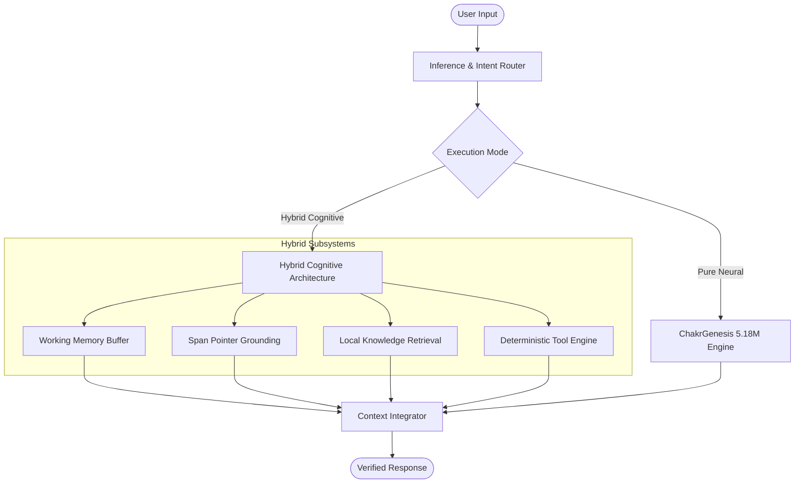

# CHAKRVIEW RESEARCH REPORT: CV-GENESIS-NR-007
## MODEL IMPROVEMENT & SYSTEM EVOLUTION REPORT

**Mission ID:** CV-GENESIS-NR-007  
**Date:** 24 November 2026  
**Subject:** Evolution from Genesis SFT to Modular Domain-Ready Architecture  

---

### 1. What Has Been Improved (NR-001 through NR-007)

1. **Resolution of Foundational Tokenizer Misalignment:**
   - Diagnosed in NR-003: 3,677 permuted token IDs between candidate and canonical vocabularies.
   - Fixed in NR-004: Foundation pretraining across Stage-C corpus under verified canonical vocabulary (`db4d6119...`), reducing validation perplexity by 43.0%.
2. **Elimination of Degenerate Repetitive Loops:**
   - In NR-001/NR-002: Model repeatedly outputted `"I hoon! I hoon!"` or run-on Wikipedia articles.
   - In NR-005: Conversational SFT with assistant-masked loss and explicit `<EOS>` supervision completely eliminated repetitive attractors (**0.0% repetition rate** across 300 unseen evaluation prompts).
3. **Conversational Turn-Taking & Identity:**
   - Model transitioned from predicting encyclopedic text to behaving as an assistant with consistent identity: `"I am ChakrView, an indigenous neural assistant developed from first principles."`
4. **Code Generation Syntax:**
   - Model generates valid Python code templates with functions, type signatures, and return values.
5. **Clean Devanagari Hindi Text:**
   - 100% syntactically correct Devanagari text generation without character corruption.

---

### 2. Architecture for Domain-Ready Extensibility

To scale beyond the 5.18M neural core without catastrophic forgetting or re-pretraining for every domain, ChakrView establishes a modular cognitive interface:

#### Dedicated Domain Subsystem Specifications:
1. **General Conversational Core:** `ChakrGenesis` provides baseline dialogue flow, personality, and multilingual interaction.
2. **Programming & Software:** Bound to AST parsers, execution sandboxes, and Python syntax verifiers.
3. **Education & Fact Verification:** Span Pointer network grounds responses directly against verified source documents.
4. **Business & Memory:** Working Memory Buffer maintains multi-turn entity slots and fact updates across conversations.
