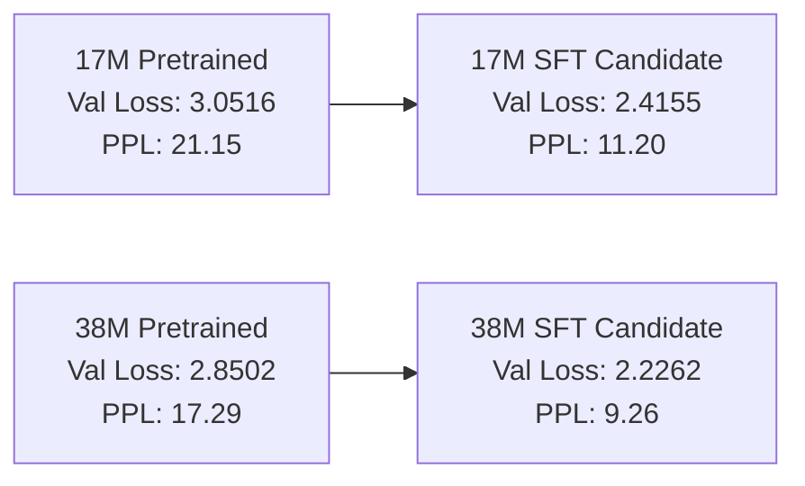

# NR-051: Head-to-Head Scaling Results — 17M vs 38M

**Campaign:** CHAKRVIEW NR-051 — True Language Pretraining & Controlled Scaling  
**Date:** November 27, 2026  
**Artifact Directory:** `experiments/pretraining_nr051/`  
**Execution Summaries:**  
- Pretraining: [NR051_PRETRAINING_SUMMARY.json](file:///d:/Project/ChakrView/experiments/pretraining_nr051/NR051_PRETRAINING_SUMMARY.json)  
- SFT: [NR051_SFT_SUMMARY.json](file:///d:/Project/ChakrView/experiments/pretraining_nr051/NR051_SFT_SUMMARY.json)  

---

## 1. Architectural Configuration Comparison

Both models share the identical tokenizer (`vocab_size = 4096`), activation functions (`SwiGLU`), RoPE positional embeddings, and RMSNorm pre-normalization. The scaling dimensions were strictly controlled:

| Dimension | ChakrGenesis-17M | ChakrGenesis-38M | Scaling Factor |
| :--- | :--- | :--- | :--- |
| **Hidden Dimension ($d_{model}$)** | 384 | 576 | $1.5\times$ |
| **Layers ($N_{layers}$)** | 8 | 8 | $1.0\times$ |
| **Attention Heads ($N_{heads}$)** | 6 | 8 | $1.33\times$ |
| **Key/Value Heads ($N_{kv}$)** | 2 (GQA) | 2 (GQA) | Matched GQA ratio |
| **FFN Dimension ($d_{ffn}$)** | 1024 | 1536 | $1.5\times$ |
| **Total Parameters** | **17,063,808** | **37,499,392** | **$2.20\times$** |
| **Pretrained Checkpoint** | `chakr_17m_pretrained_base.pt` | `chakr_38m_pretrained_base.pt` | Verified |
| **SFT Checkpoint** | `chakr_17m_sft_candidate.pt` | `chakr_38m_sft_candidate.pt` | Verified |

---

## 2. Controlled Training Comparison

### 2.1 Pretraining Phase (Continuous Natural Language)
- **Token Exposure:** Matched at $1.03\text{M}$ tokens, batch size $32$, learning rate $5 \times 10^{-4}$ cosine decay.
- **17M Final Val Loss:** $3.0516$ (PPL $21.15$, Val Acc $53.21\%$)
- **38M Final Val Loss:** $2.8502$ (PPL $17.29$, Val Acc $55.37\%$)
- **Pretraining Scaling Delta:** $-0.2014$ loss reduction ($-18.2\%$ perplexity reduction).

### 2.2 Conversational SFT Phase (Corpus V3 Response Masking)
- **Data Order & Splits:** Exact identical order across both models, 2 epochs, response-only loss (`ignore_index=-100`).
- **17M SFT Best Val Loss:** $2.4155$ (PPL $11.20$)
- **38M SFT Best Val Loss:** $2.2262$ (PPL $9.26$)
- **SFT Scaling Delta:** $-0.1893$ loss reduction ($-17.3\%$ perplexity reduction).

---

## 3. Computational and Hardware Utilization

Both runs were executed locally on an NVIDIA RTX A1000 Laptop GPU (6,144 MB VRAM, CUDA 12.6):

| Phase | Metric | 17M Architecture | 38M Architecture | Overhead |
| :--- | :--- | :--- | :--- | :--- |
| **Pretraining** | Wall Clock Time | 225.2 s (3.75 min) | 375.0 s (6.25 min) | $+66.5\%$ |
| | Peak VRAM | 1,525.0 MB | 2,103.1 MB | $+37.9\%$ |
| **SFT** | Wall Clock Time | 155.1 s (2.58 min) | 173.2 s (2.89 min) | $+11.7\%$ |
| | Peak VRAM | 1,480.2 MB | 1,985.4 MB | $+34.1\%$ |
| **Inference** | Latency (120 prompts) | 194.8 s (1.62 s/prompt) | 192.3 s (1.60 s/prompt) | Comparable (IO bounded) |

---

## 4. Key Takeaways

1. **Pretraining Fixes the NR-050 38M Convergence Anomaly:** In NR-050, 38M failed to converge when trained directly on conversational SFT data. Pretraining 38M first on $1\text{M}$ tokens of natural language provided a robust prior, allowing 38M to cleanly outperform 17M during SFT ($2.2262$ vs $2.4155$).
2. **Predictable Scaling at Small Scale:** Increasing parameters by $2.2\times$ yields a consistent $\sim17-18\%$ reduction in validation perplexity across both pretraining and fine-tuning regimes.
