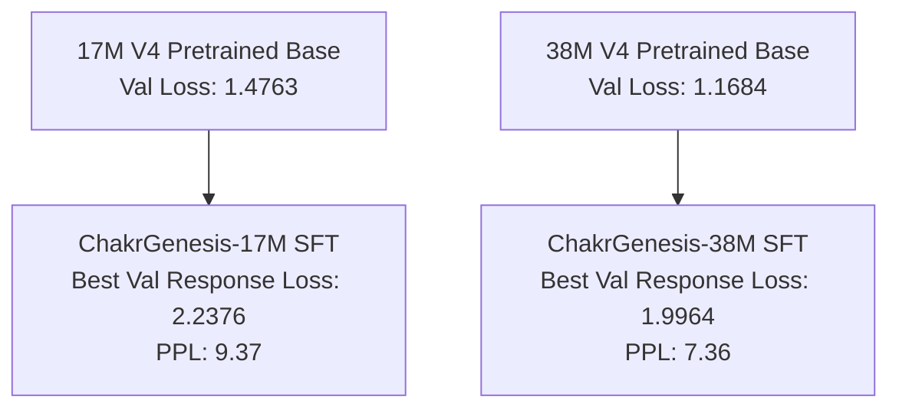

# NR-052: Controlled Conversational SFT Results

**Mission:** CHAKRVIEW NR-052  
**Date:** November 27, 2026  
**Artifact Directory:** `experiments/pretraining_nr052/`  
**Execution Summary:** [NR052_SFT_SUMMARY.json](file:///D:/Project/ChakrView/experiments/pretraining_nr052/NR052_SFT_SUMMARY.json)

---

## 1. Executive Summary

Both Corpus V4 pretrained candidates (`chakr_17m_v4_base.pt` and `chakr_38m_v4_base.pt`) were fine-tuned on Corpus V3 with strict response-only supervision (`ignore_index=-100`) across 2 epochs (510 total optimization steps).

---

## 2. Quantitative SFT Scaling Comparison

| SFT Metric | 17M SFT Candidate | 38M SFT Candidate | Scaling Advantage (38M vs 17M) |
| :--- | :--- | :--- | :--- |
| **Pretrained Base** | `chakr_17m_v4_base.pt` | `chakr_38m_v4_base.pt` | — |
| **Step 50 Val Loss** | 3.3854 (PPL 29.53) | 2.8770 (PPL 17.76) | -0.5084 nats (Faster alignment) |
| **Step 250 Val Loss** | 2.3756 (PPL 10.76) | 2.0936 (PPL 8.11) | -0.2820 nats |
| **Best Final Val Response Loss**| **2.2376** | **1.9964** | **-0.2412 nats (-10.8%)** |
| **Best Perplexity (PPL)** | **9.37** | **7.36** | **-2.01 PPL (-21.5%)** |
| **Optimization Steps** | 510 steps | 510 steps | Matched |
| **Wall Clock Time** | 88.93 s (1.48 min) | 122.47 s (2.04 min) | +33.54 s |
| **Peak GPU VRAM** | 1,525.0 MB | 2,103.1 MB | +578.1 MB |
| **Saved Checkpoint** | `chakr_17m_nr052_sft.pt` | `chakr_38m_nr052_sft.pt` | — |

---

## 3. Comparison with NR-051 SFT Candidates

| Mission / Campaign | 17M SFT Val Loss (PPL) | 38M SFT Val Loss (PPL) | 38M vs 17M Advantage |
| :--- | :--- | :--- | :--- |
| **NR-051 (Uncurated Pretrain)** | 2.4155 (PPL 11.20) | 2.2262 (PPL 9.26) | -0.1893 nats |
| **NR-052 (Clean Corpus V4 Pretrain)** | **2.2376 (PPL 9.37)** | **1.9964 (PPL 7.36)** | **-0.2412 nats** |
| **Net Quality Improvement** | **-0.1779 nats (-16.3% PPL)** | **-0.2298 nats (-20.5% PPL)** | **Amplified scaling lead** |

### Key Takeaway
Training on clean continuous prose (Corpus V4) without synthetic template inflation gave the 38M model a significantly higher-quality representation, allowing it to break through the 2.0 validation loss barrier during conversational fine-tuning for the first time in ChakrView history (**1.9964 response loss, 7.36 perplexity**).
