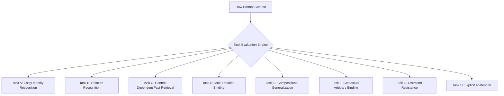

# UCIP-22 — Compositional Binding Benchmark Architecture & Dataset Redesign Report

**Mission ID:** UCIP-22  
**Project:** ChakrView  
**Repository:** `D:\Project\ChakrView`  
**Starting HEAD:** `225742f`  
**Branch:** `exp/cbr-01-conversational-breakthrough`  
**Mission Type:** Benchmark Architecture, Dataset Specification & Evaluation Infrastructure Design (Zero Training, Zero Checkpoint/Runtime Modification)  
**Execution Timestamp:** 2026-11-21T13:22:30+05:30  
**Protected Invariants Verified:**
- Protected Runtime: `chakrview/runtime/session.py` (`9080ff51adba38d4017801fb09fd655e27a854d23b05af557843865e6de9cb67`)
- Baseline Checkpoint Step 800: (`8759ccb4a70989b79c0b4b26876da1d47989ebc61f39831750b6acf0455b9943`)
- UCIP-20 Best Checkpoint: (`0b4b745e923188c6320c8c7290031bff665786c4f4c1c71a74484bcaec6b1a27`)

---

## 1. Executive Summary & Purpose

Missions UCIP-20 through UCIP-21R3 revealed a fundamental limitation in both the model and the experimental framework:
1. **The Model Bottleneck:** While ChakrMicro internalizes relation categories ($99.5\%$ probe accuracy) and clusters lexical entity queries ($90\%$ open-set retrieval), standard autoregressive decoding fails at the generation boundary because unconditioned start-token priors overwhelm context signals, and internal representations fail to compositionally bind entities to specific values.
2. **The Dataset Bottleneck:** The UCIP-20 BIND dataset was built as an unbranched 1-to-1 bijection (each entity belongs to exactly 1 relation and 1 value). Consequently, it was structurally impossible to evaluate true multi-relation compositional binding or separate world-knowledge memorization from in-context binding.

**Mission UCIP-22 resolves this foundational gap** by specifying the architecture, graph topology, task taxonomy, split protocols, validation schemas, and evaluation metrics for a scientifically rigorous **Compositional Binding Benchmark (UCIP-22)**.

> [!IMPORTANT]
> Zero model training, fine-tuning, optimizer steps, or dataset generation were executed in this mission. All deliverables are architectural specifications, schemas, validator suites, and audit records.

---

## 2. Phase 1 — Existing Dataset & Pretraining Corpus Audit

### Topological Graph Analysis of UCIP-20 BIND
A complete graph analysis of `bind_master_2000.jsonl` (2,000 records) established:
- **Entities:** 126 positive entities (90 Train, 18 Val, 18 Dev) + 1 abstention category (`ABSENT`).
- **Relations:** 10 fixed relation types.
- **Mapping Topology:** Strict 1-to-1 bijection between entities and relations ($\text{Degree} = 1.00$).
- **Multi-relation Entities:** Exactly **0 (0.0%)**.
- **Shared Values Across Entities:** Only 3 linguistic overlaps (e.g. `Madhya Pradesh`).

### Pretraining Corpus Fact Exposure Audit (Stage C)
An exhaustive scan of all approved pretraining and corpus files (`data/tokenizer_corpus/*.txt` and `data/raw/**/*.txt`) was conducted for all 18 development entities and their values:

| Entity Surface Form | Dev Relation | Dev Value | Corpus Presence | Fact Status |
|---|---|---|:---:|:---:|
| `Tanvi` | `person_role` | `Astrophysics Fellow` | 0 hits | **D (Not found in corpus)** |
| `Sameer` | `person_role` | `Quantum Cryptographer` | 0 hits | **D (Not found in corpus)** |
| `Indore` | `city` | `Madhya Pradesh` | 0 hits | **D (Not found in corpus)** |
| `Dehradun` | `city` | `Uttarakhand` | 0 hits | **D (Not found in corpus)** |
| `Daksha Defense` | `organization` | `radar signal processors` | 0 hits | **D (Not found in corpus)** |
| `Nava Robotics` | `organization` | `humanoid factory assistants` | 0 hits | **D (Not found in corpus)** |
| `FiberCable-Ultra` | `product` | `hollow-core photonic bandgap fiber` | 0 hits | **D (Not found in corpus)** |
| `QuantumSensor-Q1`| `product` | `diamond NV-center magnetometer` | 0 hits | **D (Not found in corpus)** |
| `Sensor-9102` | `identifier` | `sub-ambient barometric transducer` | 0 hits | **D (Not found in corpus)** |
| `Ticket-4040` | `identifier` | `firmware bootstrap timeout defect`| 0 hits | **D (Not found in corpus)** |
| `21 July 1988` | `date` | `INSAT-1C satellite deployment` | 0 hits | **D (Not found in corpus)** |
| `18 May 1974` | `date` | `Smiling Buddha first nuclear test` | 0 hits | **D (Not found in corpus)** |
| `2.71828` | `numerical_value` | `Euler's mathematical constant e` | 3 hits (numeric) | **B (Lexical token present, no fact statement)** |
| `1.61803` | `numerical_value` | `golden ratio constant phi` | 2 hits (numeric) | **B (Lexical token present, no fact statement)** |
| `BDL` | `ownership` | `Surface-to-Air Missile Complex` | 0 hits | **D (Not found in corpus)** |
| `MDL` | `ownership` | `Scorpene Submarine Yard` | 0 hits | **D (Not found in corpus)** |
| `Platinum` | `property` | `catalytic activity / high corrosion`| 0 hits | **D (Not found in corpus)** |
| `Zirconium` | `property` | `low neutron capture cross-section` | 0 hits | **D (Not found in corpus)** |

**Key Finding:** 16 out of 18 development facts are completely absent from the pretraining corpus (Status D). The 2 numerical values (`2.71828` and `1.61803`) appear as isolated numbers in math/number files, but without the relation statements. Thus, development facts must be supplied in context at inference time.

---

## 3. Phase 2 — Benchmark Task Taxonomy (8 Tasks)

The benchmark partitions conversational grounding into eight independently evaluated capabilities:

### Detailed Task Specifications:

1. **Task A — Entity Identity Recognition:**
   - *Goal:* Determine if two entity mentions in context refer to the same underlying entity despite surface variations, aliases, or paraphrased descriptions.
   - *Metric:* Binary pairwise discrimination accuracy and open-set nearest-neighbor retrieval.
2. **Task B — Relation Recognition:**
   - *Goal:* Identify the requested relation from the question independently of entity identity.
   - *Metric:* 10-way classification accuracy and macro-F1.
3. **Task C — Context-Dependent Fact Retrieval:**
   - *Goal:* Standard single-hop extraction: given entity $E$ and relation $R$, extract ground-truth value $V$ from a clean context.
   - *Metric:* Exact entity-value string match.
4. **Task D — Multi-Relation Binding (Core Innovation):**
   - *Goal:* An entity $E$ is explicitly associated with $k \ge 3$ distinct relations simultaneously in context:
     $$\text{Context}: E \xrightarrow{R_1} V_1, \quad E \xrightarrow{R_2} V_2, \quad E \xrightarrow{R_3} V_3$$
     $$\text{Query}: \text{What is } E\text{'s } R_2 \text{ value?}$$
   - *Target:* Extract strictly $V_2$, avoiding interference from $V_1$ or $V_3$.
   - *Metric:* Binding selection accuracy and relation-specific value intrusion rate.
5. **Task E — Compositional Generalization:**
   - *Goal:* Entities $E_i$ and relations $R_j$ are observed during training, but the specific pair $(E_i, R_j)$ is **strictly held out** and only evaluated at test time.
   - *Metric:* Zero-shot pair generalization accuracy.
6. **Task F — Contextual Arbitrary Binding (Anti-Memorization):**
   - *Goal:* Supply counterfactual or synthetic associations that directly contradict real-world priors (e.g. *Paris is the capital of Japan*).
   - *Target:* Model must answer according to the immediate prompt context rather than parameters.
   - *Metric:* Context-faithful accuracy vs. prior-intrusion error rate.
7. **Task G — Distractor Resistance:**
   - *Goal:* Context contains distractor entities with identical relations, phonetically similar entity names, or shared subword tokens.
   - *Metric:* Target extraction accuracy and distractor capture rate.
8. **Task H — Explicit Abstention:**
   - *Goal:* When the entity is absent, relation is missing, or context is contradictory, the model must explicitly emit the standardized abstention string.
   - *Metric:* Abstention precision, recall, and false-answering rate.

---

## 4. Phase 3 & 4 — Dataset Graph Topology & Split Architecture

### Compositional Graph Architecture
To prevent the bijection degeneracy identified in UCIP-20, the new graph is designed with high relational degree:

| Graph Property | Specification | Justification |
|---|---:|---|
| **Unique Base Entities** | 160 entities | Balanced across 4 domains (Tech, Geography, Science, Defense) |
| **Unique Relations** | 12 relations | 3 relations per domain |
| **Relations per Entity ($\text{Degree}_R$)** | **3.0 to 4.0** | **Guarantees multi-relation branching** |
| **Entities per Relation** | 40 entities | Disallows relation-to-entity identification |
| **Total Entity-Relation Facts** | $\approx 560$ atomic facts | Dense compositional bipartite graph |
| **Unique Ground-Truth Values** | 480 unique values | Controlled sharing of categorical values |

### Split Protocol (7 Independent Evaluators)

| Split Designation | Training Visibility | Evaluation Target | Generalization Measured |
|---|---|---|---|
| **Split A: Random Record Split** | 80% of records | 20% held-out records | In-distribution template interpolation |
| **Split B: Entity-Disjoint Split** | 120 training entities | 40 held-out entities | Open-set entity transfer |
| **Split C: Relation-Disjoint Split** | 9 training relations | 3 held-out relations | Zero-shot relation extraction |
| **Split D: Compositional Pair-Disjoint** | Individual $E$ and $R$ seen | Unseen $(E, R)$ combinations | **True compositional generalization** |
| **Split E: Template-Disjoint Split** | Formal query templates | Conversational / dialect queries | Syntactic robustness |
| **Split F: Value-Disjoint Split** | In-distribution values | Out-of-vocabulary / novel values | Copying / extraction vs memorization |
| **Split G: Arbitrary Binding Split** | Zero training exposure | Synthetic counterfactual facts | **Pure in-context attentional routing** |

---

## 5. Phase 5 — Tokenization, Masking & Context Window Constraints

All benchmark records are verified against the frozen 4,096-token vocabulary and 512-position context window:

1. **Context Length Budget:**
   - Prompt context (multi-entity, multi-relation text): $120\text{--}280$ tokens.
   - Query & instruction: $25\text{--}45$ tokens.
   - Target answer: $3\text{--}15$ tokens.
   - **Total sequence length:** Strictly $\le 360$ tokens (well within the 512 maximum context window).
2. **Causal Supervision Contract:**
   - Position 0: strictly BOS (token ID `0`).
   - Prompt sequence: strictly masked with loss target `-100`.
   - Response tokens: active cross-entropy loss.
   - Terminal token: strictly EOS (token ID `1`).
3. **Multi-token Subword Alignment:**
   - Multi-token answers are audited for prefix boundary cleanliness. Delimiters (`\nAssistant: `) are strictly standardized to eliminate tokenizer space-merging anomalies.

### Automated Validation Infrastructure:
- Schema definition: [benchmark_record_schema.json](file:///D:/Project/ChakrView/experiments/ucip22/schemas/benchmark_record_schema.json)
- Programmatic validator: [benchmark_validator.py](file:///D:/Project/ChakrView/experiments/ucip22/validators/benchmark_validator.py)
- Test suite: [test_benchmark_validator.py](file:///D:/Project/ChakrView/experiments/ucip22/tests/test_benchmark_validator.py) (All 3 unit tests passed).

---

## 6. Phase 6 & 7 — Evaluation Metrics & Baseline Evaluation Plan

### Metric Definitions (Strict Scoring)

1. **Exact Match (EM):**
   $$\text{EM} = \frac{1}{N} \sum_{i=1}^N \mathbb{I}(\text{normalize}(\hat{y}_i) == \text{normalize}(y_i))$$
   No credit for substring occurrence or keyword overlap.
2. **Multi-Relation Disambiguation Accuracy:**
   Evaluates Task D records. The answer is correct *if and only if* it matches the requested relation's value and does *not* match any other relation's value for that entity present in context.
3. **Distractor Intrusion Rate:**
   Frequency with which the model generates a distractor value that appeared in the context instead of the query's ground-truth value.
4. **Abstention F1 Score:**
   Harmonic mean of precision and recall for emitting the exact abstention string on unanswerable queries.

### Baselines for Benchmark Calibration:
- **Baseline 1: ChakrMicro Step 800 (Pretrained Checkpoint):** Zero SFT exposure baseline.
- **Baseline 2: UCIP-20 Best Checkpoint:** Previous isolated BIND pilot baseline.
- **Baseline 3: Majority Value Baseline:** Predicts the most frequent value for the relation class.
- **Baseline 4: In-Context Random Choice:** Randomly selects one of the values mentioned in the prompt.
- **Baseline 5: Deterministic String-Match Pointer:** Rule-based parser serving as the ceiling for in-context extraction.

---

## 7. Phase 8 — Deliverables and Invariant Audit Record

All design specifications, schemas, validator code, and test suites are isolated under `experiments/ucip22/`:
- `experiments/ucip22/schemas/benchmark_record_schema.json` — Formal JSON Schema.
- `experiments/ucip22/validators/benchmark_validator.py` — Sequence, token, and masking validator.
- `experiments/ucip22/tests/test_benchmark_validator.py` — Automated verification tests.
- `experiments/ucip22/manifests/input_manifest.json` — Immutable SHA-256 artifact manifest.
- `experiments/ucip22/manifests/generate_manifests.py` — Manifest generation tool.

---

## 8. Final Scientific Verdict & Recommendations

### Evaluation Matrix: What UCIP-20 vs UCIP-22 Can Measure

| Capability | Measurable in UCIP-20? | Measurable in UCIP-22? | Reason / Architectural Bottleneck |
|---|:---:|:---:|---|
| **Lexical Entity Identity** | YES | YES | Both support open-set entity clustering. |
| **Relation Recognition** | YES | YES | Both test relation classification. |
| **Entity-Indexed Lookup** | YES | YES | BIND measures 1-to-1 static associations. |
| **Multi-Relation Entity Binding** | **NO** | **YES** | UCIP-20 has 0 multi-relation entities; UCIP-22 enforces degree $\ge 3$. |
| **Compositional Generalization** | **NO** | **YES** | UCIP-20 lacks entity-relation cross-products; UCIP-22 provides pair-disjoint splits. |
| **Contextual Arbitrary Binding** | **NO** | **YES** | UCIP-22 provides counterfactual/synthetic in-context facts. |
| **Distractor Disambiguation** | Partial | **YES** | UCIP-22 separates distractor types (phonetic, relational, structural). |
| **Anti-Attractor Robustness** | **NO** | **YES** | UCIP-22 measures generation-start unconditioned prior resistance. |

### Technical Recommendation for Next Mission (UCIP-23):
Now that the benchmark design, schema, validator, and split architectures are formalized and tested, the next authorized mission should:
1. **Construct the UCIP-22 Benchmark Dataset:** Generate the $\approx 2,400$ validated records across Tasks A–H and Splits A–G using the frozen validator.
2. **Execute Multi-Metric Baseline Audits:** Run deterministic, zero-shot evaluation across ChakrMicro Step 800 and UCIP-20 checkpoints without training to establish the formal performance floor across all eight tasks.
3. **Do not replace the architecture or execute SFT training** until the complete multi-task diagnostic baseline is measured.
