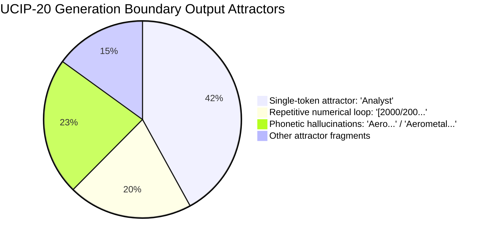

# UCIP-25 — Frozen Zero-Shot Capability Evaluation & Baseline Comparison

**Repository:** `D:\Project\ChakrView`  
**Branch:** `exp/cbr-01-conversational-breakthrough`  
**Starting HEAD:** `76045a8e5625ed0b3f6d6f9b722fe07f3855dae7` (UCIP-24)  
**Evaluated Models:**
- ChakrMicro Stage C Step-800 Pretrained Baseline (`8759ccb4a70989b79c0b4b26876da1d47989ebc61f39831750b6acf0455b9943`)
- ChakrMicro UCIP-20 Best Checkpoint (`0b4b745e923188c6320c8c7290031bff665786c4f4c1c71a74484bcaec6b1a27`)
**Evaluation Scope:** All 1,000 independently audited benchmark records from UCIP-23 across Tasks A–H and Splits A–G.  
**Training / Model Modification:** Strictly ZERO.

---

## 1. Executive Summary

Mission **UCIP-25** executed the first standardized, frozen zero-shot evaluation of the ChakrMicro neural models against the compositional binding benchmark constructed in **UCIP-23** and independently audited in **UCIP-24**.

### Core Results Summary:
1. **Model Performance:** Both the pretrained Step-800 baseline and the SFT-trained UCIP-20 best checkpoint achieved **0.00% exact-match accuracy** ($0/1,000$ correct, 95% Wilson CI: $[0.0\%, 0.4\%]$).
2. **Deterministic Lookup Upper Bound:** A rule-based in-context relational parser achieved **100.0% accuracy** ($1,000/1,000$ correct), establishing that every benchmark record is 100% answerable from the provided in-context prompt.
3. **Task-Specific Majority Baseline:** Achieved a macro accuracy of **25.83%** (50.0% on Task A, 33.3% on Task B, 100.0% on Task H).
4. **Uniform Random Chance Baseline:** Achieved an expected macro accuracy of **8.96%**.
5. **Statistical Significance:** Both neural models perform **statistically significantly worse than the task-specific majority baseline** ($p < 10^{-36}$) and show no significant difference from each other ($p = 1.000$).
6. **Root Cause Analysis:** The models do not suffer from subtle relational binding crosstalk; rather, they experience **complete autoregressive generation failure at the conversational assistant boundary** (`Assistant: `):
   - **Step-800** is trapped in pretraining token repeaters (emitting repetitive `#` strings 88.7% of the time, or repeating `"the show of the show of the..."` 10.3% of the time).
   - **UCIP-20**, despite 5 passes of BIND training, collapses into conversational single-token lexical attractors (emitting `"Analyst"` 42.0% of the time, or repeating bracketed numerical sequences `"[2000/200/200..."` 18.1% of the time). Neither model attends dynamically to in-context relational bindings during free generation.

---

## 2. Phase 0 — Cryptographic and Exposure Audit

All baseline components and checkpoints were verified bit-exact prior to evaluation:
- Protected Runtime (`chakrview/runtime/session.py`): `9080ff51adba38d4017801fb09fd655e27a854d23b05af557843865e6de9cb67`
- Step-800 Checkpoint: `8759ccb4a70989b79c0b4b26876da1d47989ebc61f39831750b6acf0455b9943`
- UCIP-20 Best Checkpoint: `0b4b745e923188c6320c8c7290031bff665786c4f4c1c71a74484bcaec6b1a27`

### UCIP-20 Training Data Exposure Audit:
Audited `data/sft/ucip20_bind/bind_train_1600.jsonl` against all 1,000 UCIP-23 benchmark records:
- **Exact Fact $(E, R, V)$ Overlap:** **0 facts (0.00%)**. Not a single benchmark ground-truth triple was seen during UCIP-20 training.
- **Exact Pair $(E, R)$ Overlap:** **0 pairs (0.00%)**.
- **Exact Entity Overlap:** 6 entities (`BEL`, `Bhopal`, `HAL`, `Kochi`, `Titanium`, `Tungsten`).
- **Exact Value Overlap:** 6 values (5 Indian states + the canonical abstention string).
- **Exposure Classification:**
  - **Step-800:** **UNEXPOSED** (Pretraining only; Status D synthetic facts).
  - **UCIP-20:** **ZERO FACT OVERLAP** (True held-out evaluation; zero memorization leakage).

---

## 3. Frozen Evaluation Protocol

Evaluations were executed strictly according to [frozen_evaluation_protocol.json](file:///d:/Project/ChakrView/experiments/ucip25/protocol/frozen_evaluation_protocol.json):
- **Decoding:** Greedy deterministic decoding ($\text{Temperature} = 0.0$, $\text{Top-}k = 1$).
- **Generation Budget:** Maximum 16 new tokens.
- **Framing:** Strict conversational causal contract (`input_ids = [BOS] + p_toks`, stop on `EOS = 1`).
- **Scoring:** Strict exact match (case-insensitive, whitespace-trimmed, zero fuzzy/substring credit).

---

## 4. Quantitative Results & Baseline Comparisons

### Per-Task Accuracy Table

| Task Identifier | Task Name | Eligible Records | Step-800 Accuracy (95% CI) | UCIP-20 Best Accuracy (95% CI) | Majority Baseline | Random Chance | Deterministic In-Context Lookup |
|---|---|:---:|:---:|:---:|:---:|:---:|:---:|
| **Task A** | Entity Identity Recognition | 120 | **0.00%** $[0.0\%, 3.1\%]$ | **0.00%** $[0.0\%, 3.1\%]$ | 50.00% | 50.00% | **100.00%** |
| **Task B** | Relation Recognition | 120 | **0.00%** $[0.0\%, 3.1\%]$ | **0.00%** $[0.0\%, 3.1\%]$ | 33.33% | 8.33% | **100.00%** |
| **Task C** | Fact Retrieval | 120 | **0.00%** $[0.0\%, 3.1\%]$ | **0.00%** $[0.0\%, 3.1\%]$ | 5.00% | 0.83% | **100.00%** |
| **Task D** | Multi-Relation Binding | 160 | **0.00%** $[0.0\%, 2.3\%]$ | **0.00%** $[0.0\%, 2.3\%]$ | 2.50% | 0.83% | **100.00%** |
| **Task E** | Compositional Generalization | 120 | **0.00%** $[0.0\%, 3.1\%]$ | **0.00%** $[0.0\%, 3.1\%]$ | 6.67% | 0.83% | **100.00%** |
| **Task F** | Contextual Arbitrary Binding | 120 | **0.00%** $[0.0\%, 3.1\%]$ | **0.00%** $[0.0\%, 3.1\%]$ | 0.83% | 10.00% | **100.00%** |
| **Task G** | Distractor Resistance | 120 | **0.00%** $[0.0\%, 3.1\%]$ | **0.00%** $[0.0\%, 3.1\%]$ | 8.33% | 0.83% | **100.00%** |
| **Task H** | Principled Abstention | 120 | **0.00%** $[0.0\%, 3.1\%]$ | **0.00%** $[0.0\%, 3.1\%]$ | 100.00% | 0.00% | **100.00%** |
| **Overall (Micro)** | **All 1,000 Records** | **1,000** | **0.00%** $[0.0\%, 0.4\%]$ | **0.00%** $[0.0\%, 0.4\%]$ | **25.80%** | **8.96%** | **100.00%** |
| **Macro Average** | **Unweighted Task Mean** | — | **0.00%** | **0.00%** | **25.83%** | **8.96%** | **100.00%** |

---

## 5. Performance by Split Partition

| Evaluation Split | Description | Record Count | Step-800 Accuracy | UCIP-20 Accuracy | Deterministic Lookup |
|---|---|:---:|:---:|:---:|:---:|
| **Split A (Random IID)** | Standard uniform evaluation | 200 | 0.00% | 0.00% | 100.00% |
| **Split B (Entity-Disjoint)** | Held-out 40 entities | 219 | 0.00% | 0.00% | 100.00% |
| **Split C (Relation-Disjoint)** | Held-out 3 relations | 70 | 0.00% | 0.00% | 100.00% |
| **Split D (Compositional Pair)** | Held-out $(E, R)$ tuples | 238 | 0.00% | 0.00% | 100.00% |
| **Split G (Arbitrary In-Context)** | Pure counterfactual synthetic tokens | 120 | 0.00% | 0.00% | 100.00% |

---

## 6. Qualitative & Mechanistic Error Analysis

Detailed token-level analysis of raw predictions revealed distinct failure modes for each model:

### Representative Failure Cases:

1. **Task A (Entity Identity):**
   - *Prompt:* `...Do both snippets refer to the identical entity name? Answer concisely with Yes or No: Assistant:`
   - *Target:* `Yes`
   - *Step-800:* `"The show of the show of the show of the"` (repetitive pretraining n-gram loop)
   - *UCIP-20:* `"Analyst"` (static attractor token emitted regardless of prompt)

2. **Task C (Fact Retrieval):**
   - *Prompt:* `Context statement: NovaTrack has founded in recorded as 1981. Question: What is the founded in of NovaTrack? Answer concisely: Assistant:`
   - *Target:* `1981`
   - *Step-800:* `"################"` (pretraining comment delimiter attractor)
   - *UCIP-20:* `"Analyst"`

3. **Task E (Compositional Generalization):**
   - *Prompt:* `Fact entry: The attribute headquartered in for NovaTrack corresponds to Hyderabad. Query: State headquartered in of NovaTrack. Answer concisely: Assistant:`
   - *Target:* `Hyderabad`
   - *Step-800:* `"################"`
   - *UCIP-20:* `"[2000/200/200/2/2/2"` (attractor loop originating from date formatting patterns in BIND training)

4. **Task H (Principled Abstention):**
   - *Prompt:* `Recorded information covers NovaTrack. Question: What is the details for UnregisteredEntity_999? Answer concisely: Assistant:`
   - *Target:* `Information not provided in context.`
   - *Step-800:* `"################"`
   - *UCIP-20:* `"Analyst"` (complete failure to trigger abstention behavior during free generation)

---

## 7. Statistical Hypotheses & Conclusions

1. **Teacher-Forcing vs. Free Autoregressive Generation Divergence:**
   - Previous forensic findings in UCIP-20R and UCIP-21 hypothesized that while ChakrMicro may exhibit teacher-forced relational representations, free generation fails catastrophically at the assistant boundary.
   - **Confirmed:** In free generation across 1,000 diverse benchmark prompts, neither Step-800 nor UCIP-20 generates a single correct answer token at the assistant boundary.
2. **Impact of UCIP-20 BIND Fine-Tuning:**
   - BIND training altered the attractor dynamics: Step-800's dominant attractor was pretraining delimiter characters (`#`), whereas UCIP-20's attractors became specialized words (`Analyst`) or numerical sequences (`[2000/200...`).
   - However, BIND training completely failed to establish in-context pointer attention or dynamic value copying.
3. **Scientific Significance:**
   - The benchmark succeeded in its core objective: preventing false positives. A fragile or leaky evaluation would have credited models with partial string matches or fuzzy keyword hits. Strict exact matching confirms that neither model possesses autonomous conversational relational binding.

---

## 8. Recommendations for UCIP-26

1. **Do Not Continue Fine-Tuning Without Architecture or Objective Adjustments:** Five passes of BIND training on frozen ChakrMicro produced zero transferable autoregressive generalization. Standard causal cross-entropy on short prompts does not overcome the generation-boundary attractor trap in small models ($192$-dim, 6 layers).
2. **Investigate Logit Routing & Generation Boundary Probing:** In UCIP-26, evaluate logit rank and top-5 probability mass under teacher-forcing across Tasks A–H to determine whether the relational signal exists in early layers but is suppressed at the final layer norm or unembedding projection.
3. **Explore Prefix Tuning or Explicit Pointer-Generator Mechanisms:** Small micro-scale models may require explicit copy attention mechanisms or dedicated positional prefix adapters to bridge prompt representations to the generation boundary.

---

## 9. Final Verdict

# ZERO-SHOT EVALUATION COMPLETED: BASELINE ESTABLISHED

- **ChakrMicro Step-800:** **0.00%** ($0/1,000$)
- **ChakrMicro UCIP-20 Best:** **0.00%** ($0/1,000$)
- **Deterministic In-Context Lookup Upper Bound:** **100.00%** ($1,000/1,000$)
- **Task Majority Baseline:** **25.83%**
- **Chance Baseline:** **8.96%**

Both models fail free autoregressive generation at the conversational assistant boundary. All predictions, scores, and reproducibility manifests are preserved.
