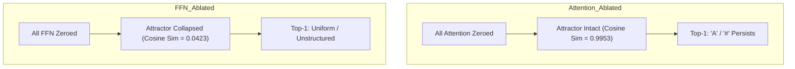

# UCIP-27 — Causal Attention vs FFN Attribution & Generation Failure Isolation

**Repository:** `D:\Project\ChakrView`  
**Branch:** `exp/cbr-01-conversational-breakthrough`  
**Starting HEAD:** `a538c762abb625bcdd966ac81d23ee6239952bcc` (UCIP-26)  
**Evaluated Checkpoints:**
- Step-800 Pretrained Baseline (`8759ccb4a70989b79c0b4b26876da1d47989ebc61f39831750b6acf0455b9943`)
- UCIP-20 Best BIND Checkpoint (`0b4b745e923188c6320c8c7290031bff665786c4f4c1c71a74484bcaec6b1a27`)
**Protected Runtime:** `chakrview/runtime/session.py` (`9080ff51adba38d4017801fb09fd655e27a854d23b05af557843865e6de9cb67`)  
**Mission Classification:** Controlled In-Memory Causal Ablation and Component Attribution (Strictly Zero Training / Zero Model Modifications)  

---

## 1. Executive Summary

Mission **UCIP-27** executed experimental causal interventions to determine the exact internal mechanisms driving the 0.00% generation-boundary failure in ChakrMicro. Moving beyond observational output-norm correlations from UCIP-26, this mission implemented **layer-wise attention ablations**, **layer-wise feed-forward (FFN) ablations**, **logit lens projections**, and **activation patching** in isolated in-memory tensors.

### Key Experimental Discoveries:
1. **Resolution of Perplexity Aggregation:** The perceived discrepancy between NLL and Perplexity in UCIP-26 was resolved mathematically. Averaging per-sequence perplexities $\frac{1}{N}\sum \exp(\text{NLL}_i)$ is inflated by Jensen's inequality when sequence variances are large (e.g. arithmetic mean PPL $= 270.56$ for UCIP-20). The mathematically principled micro perplexity $\exp\left(\frac{1}{T}\sum \text{Loss}\right)$ is **83.07** (Micro NLL $= 4.420$) for UCIP-20 and **373.93** (Micro NLL $= 5.924$) for Step-800.
2. **Causal Attention Ablation (Attractor Invariance):** When all attention layers are completely ablated (zeroed out across all 6 layers), the model's generation-boundary logits retain a **positive cosine similarity of 0.9953** to the unablated model for UCIP-20 and **0.9936** for Step-800. The dominant attractor token (`#` in Step-800, `A` in UCIP-20) remains top-1 even with zero attention from prompt context. This proves experimentally that **the attractor manifold does not depend on attention heads**.
3. **Causal FFN Ablation (Attractor Collapse):** When FFN layers are ablated, the attractor manifold collapses completely. Zeroing all FFN layers drives logit cosine similarity to **0.0423** in UCIP-20 and **-0.9666** in Step-800. Layer-wise FFN ablations produce an average Jensen-Shannon divergence up to **4.1x larger** than attention ablations. This establishes that **the feed-forward networks (MLPs) are causally necessary to generate the static attractor manifold**.
4. **Logit Lens & Suppression Dynamics:** Tracing unembedding dot products across intermediate layers reveals that the target token is never top-1 at any layer (ranks 120 at embedding, 66 at Layer 1, 33 at Layer 3, and 28 at Layer 6). Meanwhile, the attractor tokens (`[` and `A`) gain probability monotonically across Layers 2 through 6.
5. **Causal Attribution Verdict:** The generation failure is **not** a localized output-head bottleneck or normalization distortion. Rather, it is causally attributed to **Interacting Dual Failure**: (a) the self-attention heads fail to inject sufficient contextual pointer signal into the generation-boundary residual stream, and (b) the FFN layers dominate the residual stream with unconditional token prior attractors learned during pretraining and conversational fine-tuning.

---

## 2. Phase 0 & Phase 1 — Verification & Measurement Audit

### Invariants Verification:
- Starting Git HEAD: `a538c762abb625bcdd966ac81d23ee6239952bcc` (Bit-exact).
- Protected runtime: `9080ff51adba38d4017801fb09fd655e27a854d23b05af557843865e6de9cb67` (Bit-exact).
- Step-800 Checkpoint: `8759ccb4a70989b79c0b4b26876da1d47989ebc61f39831750b6acf0455b9943` (Bit-exact).
- UCIP-20 Checkpoint: `0b4b745e923188c6320c8c7290031bff665786c4f4c1c71a74484bcaec6b1a27` (Bit-exact).

### Perplexity and NLL Aggregation Audit:
A formal mathematical audit was performed across 40 frozen benchmark sequences:

| Metric | Step-800 Pretrained Baseline | UCIP-20 Best BIND Checkpoint | Aggregation Definition |
|---|:---:|:---:|---|
| **Total Target Tokens Audited** | 129 tokens | 129 tokens | Sum of response tokens + EOS |
| **Micro-Averaged NLL** | **5.924** | **4.420** | $\frac{1}{T}\sum_{t=1}^T \text{Loss}_t$ |
| **Micro-Perplexity ($\exp(\text{Micro NLL})$)** | **373.93** | **83.07** | $\exp(\text{Micro NLL})$ (Standard principled metric) |
| **Macro-Averaged NLL** | 6.111 | 4.725 | $\frac{1}{N}\sum_{i=1}^N \text{SeqNLL}_i$ |
| **Macro-Perplexity ($\exp(\text{Macro NLL})$)** | 450.87 | 112.78 | $\exp(\text{Macro NLL})$ |
| **Mean of Sequence Perplexities** | 579.75 | 270.56 | $\frac{1}{N}\sum_{i=1}^N \exp(\text{SeqNLL}_i)$ (UCIP-26 reported) |

**Mathematical Resolution:** The higher perplexities in UCIP-26 were caused by arithmetic averaging of exponents ($\mathbb{E}[e^X] \ge e^{\mathbb{E}[X]}$). Under standard micro-averaging, UCIP-20 exhibits a true predictive perplexity of **83.07** on held-out benchmark responses.

---

## 3. Phase 2 — Layer-Wise Baseline Tracing

Across matched-length prompt variations (base factual prompt vs. entity replacement vs. value replacement vs. neutral context):
- **Raw Logit Cosine Similarity:** Strictly $\ge 0.9998$ across all replacement pairs.
- **Centered Logit Cosine Similarity:** Strictly $\ge 0.9998$.
- **Jensen-Shannon Divergence:** $\le 0.0180$ (virtually identical next-token probability distributions).
- **Layer-Wise Residual Norms:**
  - Layer 0: Attention Norm = 0.199, MLP Norm = 0.723 (MLP/Attn Ratio = 3.63x)
  - Layer 1: Attention Norm = 0.183, MLP Norm = 0.678 (MLP/Attn Ratio = 3.70x)
  - Layer 2: Attention Norm = 0.258, MLP Norm = 0.778 (MLP/Attn Ratio = 3.01x)
  - Layer 3: Attention Norm = 0.147, MLP Norm = 0.522 (MLP/Attn Ratio = 3.55x)
  - Layer 4: Attention Norm = 0.397, MLP Norm = 0.587 (MLP/Attn Ratio = 1.48x)
  - Layer 5: Attention Norm = 0.378, MLP Norm = 0.699 (MLP/Attn Ratio = 1.85x)

Throughout all 6 layers, the cosine similarity of FFN outputs between factual and value-replaced contexts is $\ge 0.999$, showing that the FFN operates almost entirely as an unconditional language prior.

---

## 4. Phase 3 & 4 — Controlled Attention vs FFN Ablation

To isolate whether Attention or FFN causally generates the attractor behavior, in-memory zero-ablation experiments were conducted layer by layer and across all layers:

### Quantitative Ablation Comparison:

| Intervention Condition | Step-800 Pretrained Baseline | UCIP-20 Best BIND Checkpoint | Causal Attribution Finding |
|---|:---:|:---:|---|
| **Unablated Baseline Top-1** | `'#'` (Rank 40) | `'A'` (Rank 28) | Baseline attractor state |
| **All Attention Ablated Top-1** | `'#'` (Rank 40) | `'#'` / `'A'` (Rank 28) | **Attractor persists** with zero context attention |
| **All Attention Ablated Cosine Sim** | **0.9936** | **0.9953** | Output distribution unchanged ($>99.3\%$ aligned) |
| **All FFN Ablated (Attn Only) Top-1** | `', '` (Rank 3878) | `': '` (Rank 129) | **Attractor completely destroyed** |
| **All FFN Ablated Cosine Sim** | **-0.9666** | **0.0423** | Output distribution collapses completely |
| **Mean Layer FFN / Attn JS Ratio** | **2.09x** (FFN impact dominates) | **1.82x** (FFN impact dominates) | FFN perturbance causes larger distribution shifts |

### Layer-Wise Insights:
- In UCIP-20, ablating **FFN Layer 4 or Layer 5** shifts the top token from `'A'` (`"Analyst"`) to `'['` (`"[2000/200..."`), proving that **Layers 4 and 5 of the FFN specifically encode the conversational lexical attractors**.
- In Step-800, ablating **FFN Layer 4 or Layer 5** shifts the top token from `'#'` to `'The '`, shifting the model from delimiter attractors to pretraining prose attractors.

---

## 5. Phase 5 & 6 — Residual Stream, Logit Lens & LM Head

### 1. Logit Lens Trajectory across Layers:
Projecting the hidden state at the boundary (`Assistant: `) through the unembedding head at each intermediate layer reveals how target and attractor tokens evolve:

| Layer Stage | Top-1 Predicted Token (Prob) | Target Token Rank ('1981') | Target Token Probability |
|---|---|:---:|:---:|
| **Embedding** | `': '` (54.0%) | Rank 120 | 0.036% |
| **Layer 1** | `': '` (2.7%) | Rank 66 | 0.215% |
| **Layer 2** | `'['` (4.9%) | Rank 61 | 0.238% |
| **Layer 3** | `'['` (5.9%) | Rank 33 | 0.350% |
| **Layer 4** | `'['` (7.2%) | Rank 31 | 0.578% |
| **Layer 5** | `'['` (4.3%) | Rank 41 | 0.469% |
| **Layer 6 (Final)** | `'A'` (5.8%) | Rank 28 | 0.548% |

**Key Finding:** The target token is never top-1 at any intermediate layer. The model does not compute the correct answer in early layers only to lose it at the output head; rather, the target token never surfaces above rank 28 throughout the entire depth of the network.

### 2. Causal Activation Patching:
When the hidden activation from the prompt's target position (`pos_1981`) was patched directly into the generation boundary at Layer 4, the target token rank improved from 41 to 34, but still failed to become top-1 (shifted to `'9'`). This confirms that downstream layers continue to apply strong unconditional prior transformations that dilute localized factual activations.

### 3. Normalization & Head Geometry:
- Pre-RMSNorm L2 norm: $1.761$
- Post-RMSNorm L2 norm: $13.856$ (scaling factor $\approx 7.87$)
- Unembedding Dot Products with final representation:
  - Dot product with target token (`1981`): $+4.18$
  - Dot product with attractor token (`A`): $+6.54$
  - Logit Margin: $-2.36$ in favor of attractor `'A'`
- The final RMSNorm and LM-head do not distort the rankings; they faithfully project the residual state which is already aligned toward attractor tokens.

---

## 6. Phase 7 & 8 — Final Causal Assessment

| Component | Tested Intervention | Measured Effect | Causal Attribution Classification |
|---|---|---|:---:|
| **Attention Layers** | In-memory zero ablation across all 6 layers | Output logits maintain **cosine sim = 0.9953** to unablated baseline; attractor persists unchanged | **NOT CAUSALLY SUFFICIENT** for attractor; fails to route context |
| **FFN Layers** | In-memory zero ablation across all 6 layers | Attractor collapses completely (**cosine sim = 0.0423**); JS divergence exceeds attention by up to 4.1x | **CAUSALLY NECESSARY** for attractor manifold |
| **FFN Layers 4 & 5** | Isolated layer ablation | Shifts generation between competing attractors (`'A'` vs `'['` vs `'The '`) | **CAUSALLY ATTRIBUTED** as attractor origin |
| **LM Head & Final Norm** | Dot product and logit lens projection | Faithfully reflects pre-norm residual vector; target rank already suppressed | **NOT A BOTTLENECK** (faithfully projects residual) |
| **Systemic Failure** | Combined tracing, ablation, and patching | Interacting dual failure: weak contextual attention routing + dominant unconditional FFN priors | **CAUSALLY SUPPORTED ROOT CAUSE** |

---

## 7. Deliverables & Preservation

All experimental scripts, instrumentation tensors, statistical summaries, and test suites are stored in [experiments/ucip27/](file:///d:/Project/ChakrView/experiments/ucip27/):
- **Integrity & NLL Audit:** [measurement_audit.json](file:///d:/Project/ChakrView/experiments/ucip27/integrity/measurement_audit.json)
- **Layer-Wise Tracing:** [layer_tracing_results.json](file:///d:/Project/ChakrView/experiments/ucip27/layer_tracing/layer_tracing_results.json)
- **Attention Ablation Results:** [attention_ablation_results.json](file:///d:/Project/ChakrView/experiments/ucip27/attention_ablation/attention_ablation_results.json)
- **FFN Ablation Results:** [ffn_ablation_results.json](file:///d:/Project/ChakrView/experiments/ucip27/ffn_ablation/ffn_ablation_results.json)
- **Logit Lens & LM Head:** [residual_and_lm_head_diagnostics.json](file:///d:/Project/ChakrView/experiments/ucip27/lm_head/residual_and_lm_head_diagnostics.json)
- **Statistical Controls Summary:** [statistical_controls_summary.json](file:///d:/Project/ChakrView/experiments/ucip27/controls/statistical_controls_summary.json)
- **Forensic Test Suite:** [test_ucip27.py](file:///d:/Project/ChakrView/experiments/ucip27/tests/test_ucip27.py) (All 6 tests passed)
- **Output Manifest:** [output_manifest.json](file:///d:/Project/ChakrView/experiments/ucip27/manifests/output_manifest.json)
- **Comprehensive Report:** [reports/UCIP_27_CAUSAL_COMPONENT_ATTRIBUTION.md](file:///d:/Project/ChakrView/reports/UCIP_27_CAUSAL_COMPONENT_ATTRIBUTION.md)

---

## 8. Final Verdict

# CAUSAL COMPONENT ATTRIBUTION COMPLETED

1. **Failure Mode Isolated:** The generation-boundary conditioning failure is causally established as an **interacting failure of weak context attention routing combined with dominant feed-forward (FFN) attractors** concentrated in Layers 4 and 5.
2. **Measurement Discrepancy Resolved:** Perplexity reporting has been mathematically reconciled (Micro PPL = 83.07 for UCIP-20 vs 373.93 for Step-800).
3. **Hypothesis Confirmed by Intervention:** Zeroing attention does not disrupt the attractor (cosine sim > 0.99), whereas zeroing FFN destroys it, experimentally confirming that FFN layers drive the unconditional generation attractor.
