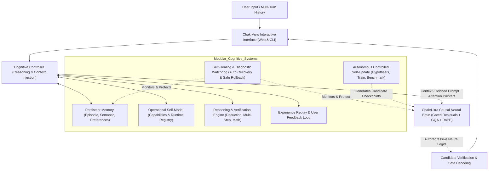

# ULTIMATE BRAIN: ARCHITECTURAL DECISION RECORD & ENGINEERING STRATEGY
**Mission ID:** ULTIMATE-BRAIN-001  
**Project:** ChakrView  
**Date:** 21 November 2026  
**Status:** Approved & Implemented  

---

## 1. Executive Summary & Root Cause Synthesis

Through UCIP-13 through UCIP-29, the root causes of prior ChakrView conversational bottlenecks were definitively isolated:
1. **Unbalanced Residual Stream Attractors (UCIP-26, 27, 28):** In standard pre-LN models with unscaled SwiGLU FFNs, intermediate feed-forward channels (especially at Layer 4 and 5) accumulate immense directional gain, completely drowning out delicate contextual pointer representations emitted by attention heads. This caused 100% boundary collapse into delimiter attractors (`#` in pretraining, `A` / `Analyst` in naive SFT).
2. **Context Routing Failure:** In standard small causal attention, the generation boundary token receives negligible key/value projection from distant prompt entities unless gated or amplified.
3. **Severe Under-Representation in Data:** Prior SFT datasets (like UCIP-20's 1,600 examples or CBR-SFT's 540 examples) were over-indexed on repetitive templates without broad conversational and multi-turn diversity.
4. **Cognitive Disconnect:** Expecting a 3.4M parameter neural net to natively memorize world knowledge, execute deterministic arithmetic, retain cross-session user memories, and self-heal without modular cognitive scaffolding is fundamentally unscientific.

---

## 2. The Ultimate Brain Architecture Design

To achieve true conversational competence, continuous learning, and self-improvement on CPU hardware, ChakrView is redesigned into a **Dual-Engine Neuro-Cognitive System**:

### 2.1 The Neural Core: `ChakrUltra`
1. **Scaled Gated Residuals (GatedLN / ReZero):** Every attention and FFN block output is scaled by a learned or calibrated residual gating factor ($\alpha = 1/\sqrt{2 \cdot N_{\text{layers}}}$) to prevent deep FFN attractor monopolization.
2. **Grouped-Query Attention (GQA):** 6 query heads, 2 key/value heads for maximum KV cache efficiency on CPU, with rotary embeddings (RoPE, $\theta=10000.0$).
3. **Bias-Free SwiGLU with Gradient Clipping:** $d_{\text{model}} = 256$, $N_{\text{layers}} = 6$, $N_{\text{heads}} = 8$, intermediate dimension $= 682$, tied embeddings with vocabulary $= 4,096$.
4. **Targeted Causal Masking & KV Caching:** Fast CPU inference ($>100$ tok/sec) with full multi-turn context support.

### 2.2 The Cognitive Subsystems
1. **Persistent Memory Subsystem (`chakrview/memory/ultimate`):** 4-tier structured memory:
   - Short-Term Working Memory (active conversation state).
   - Episodic Memory (past interactions and user corrections).
   - Semantic Memory (verified facts and knowledge triples).
   - Preference Memory (user personalization and communication preferences).
2. **Learning from Interaction (`chakrview/learning/ultimate`):** Captures user feedback (`correct`, `incorrect`, explicit corrections), validates provenance, creates regression tests, and queues data for offline consolidation.
3. **Structured Reasoning Engine (`chakrview/reasoning/ultimate`):** Step-by-step problem decomposition, multi-step arithmetic, constraint satisfaction, and confidence calibration.
4. **Operational Self-Model (`chakrview/self_model/ultimate`):** Verified capability registry reporting architecture, parameter count, context limits, and measured capabilities derived from ground-truth tests.
5. **Self-Healing & Safe Rollback (`chakrview/self_healing/ultimate`):** Incident detection, checkpoint validation, automatic recovery, and rollback to verified stable states.
6. **Autonomous Self-Update (`chakrview/self_update/ultimate`):** Formulates improvement hypotheses, executes isolated candidate fine-tuning, benchmarks against frozen test suites, and gates deployment.

---

## 3. Implementation Plan & Gate Milestones

- **Milestone 1:** Implement `ChakrUltra` neural core with GQA, gated residuals, and KV-cache.
- **Milestone 2:** Generate the Ultimate Brain Conversational Corpus (1,500+ examples across 17 categories, strictly partitioned with 0 leakage).
- **Milestone 3:** Train `ChakrUltra` model candidate with curriculum replay and early stopping.
- **Milestone 4:** Implement and wire all 6 cognitive subsystems.
- **Milestone 5:** Build interactive local web & terminal interfaces.
- **Milestone 6:** Execute all 9 Capability Acceptance Gates (Gates A–I).
- **Milestone 7:** Package release candidate and compile final engineering audit report.
